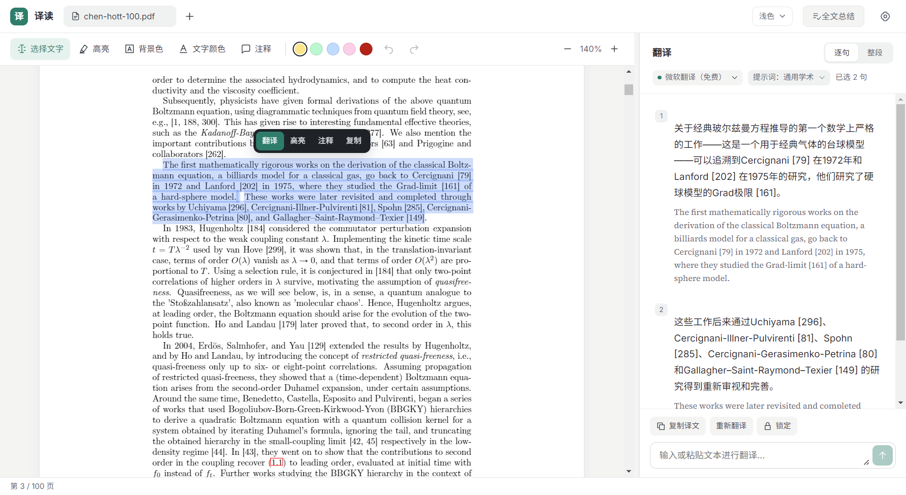
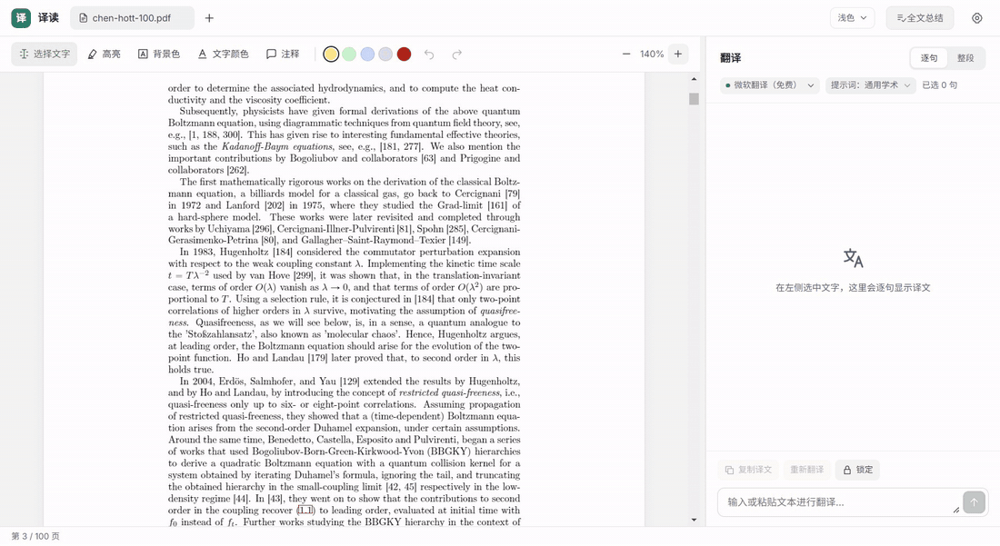
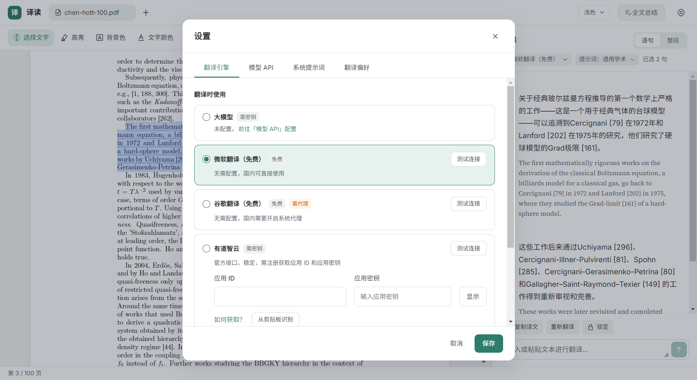
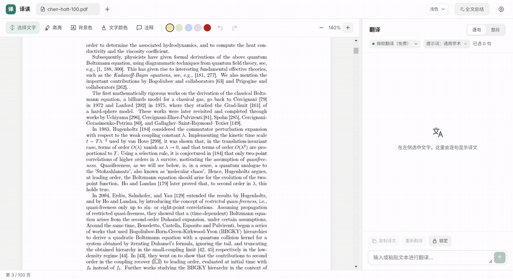
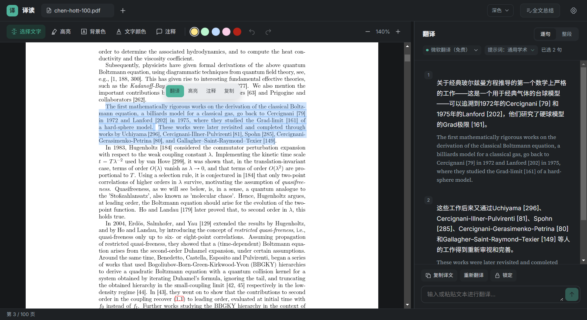
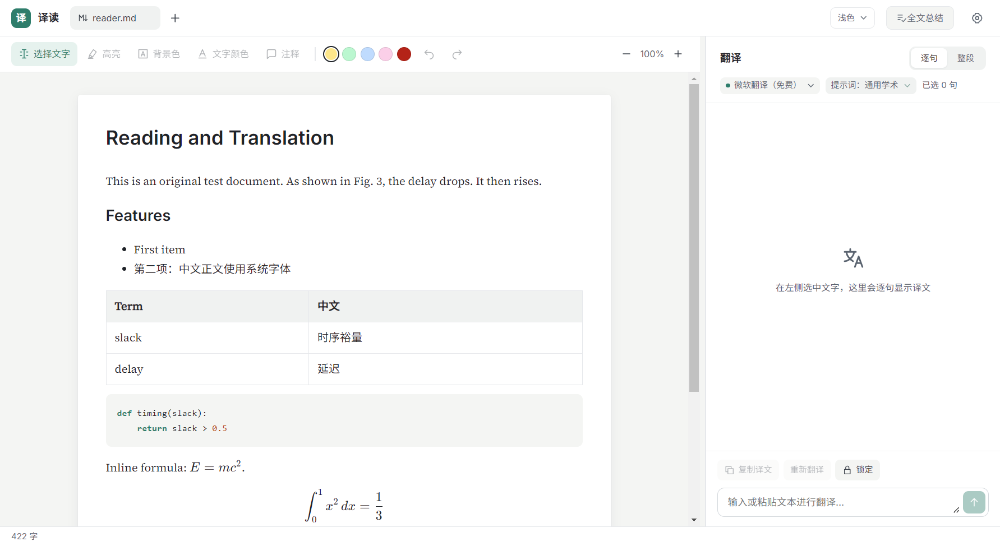

<p align="center">
  <picture>
    <source media="(prefers-color-scheme: dark)" srcset="docs/images/logo-wordmark-dark.png">
    
  </picture>
</p>

<p align="center"><b>开源的论文翻译阅读器：选中即逐句对照翻译，支持大模型与免费翻译引擎。</b></p>

<p align="center">
  <a href="LICENSE"></a>
  
  <a href="https://github.com/pph-hpp/yidu/stargazers"></a>
</p>

<p align="center"><a href="README.md">English</a> | 中文</p>

<p align="center">
  
</p>

译读（Yidu）是一款桌面文献阅读器：左边读 PDF / Markdown，右边逐句显示「译文在上、原文在下」的对照翻译。可以接入你自己的大模型 API 并注入领域提示词，也可以不配置任何密钥，直接用免费引擎翻译。

## 功能

### 逐句对照翻译



*演示：在 PDF 中选中一段文字，右栏按句给出译文与原文，可在「逐句 / 整段」间切换。* [观看高清视频（MP4）](docs/images/demo-translate.mp4)

- **选中即翻译**：自动清洗换行和连字符、按句切分，一句一卡片，译文在上、原文在下。
- **多种翻译引擎**：OpenAI 兼容接口（DeepSeek、通义、智谱、Moonshot、本地 Ollama 等）、Anthropic、Azure OpenAI；也内置**免费**的微软（Bing）与谷歌翻译，以及有道智云官方接口。
- **领域提示词**：为大模型配置系统提示词和术语表，专业术语译得更准。
- **按句操作**：复制、重译、编辑原文后重译、锁定当前译文；还支持输入任意文本翻译。

### 翻译引擎，开箱即用

<p align="center"></p>

没有 API Key 也能直接翻译：默认使用免费的微软翻译。需要更好的术语质量时，在「模型 API」中配置大模型即可；大模型请求失败时还可自动回退到免费引擎。

### 全文总结

一键把整篇论文交给大模型，生成包含研究问题、方法、结论、关键术语的阅读报告，保存为 Markdown；还可以把总结加入提示词，作为后续翻译的领域背景。（需要配置大模型）

### PDF 标注



*演示：高亮、背景色、文字颜色三种标注。* [观看高清视频（MP4）](docs/images/demo-annotate.mp4)

高亮、背景色、文字颜色和便签都写成标准 PDF 注释，Acrobat 和浏览器里同样可见；支持撤销 / 重做，`Ctrl+S` 原子保存，关闭前提醒未保存的修改。

### 更多

<table>
  <tr>
    <td width="50%"></td>
    <td width="50%"></td>
  </tr>
  <tr>
    <td align="center">深色模式</td>
    <td align="center">Markdown 阅读：表格、代码高亮、公式</td>
  </tr>
</table>

## 快速开始

1. 安装 [Node.js 22](https://nodejs.org/) 与 Git。
2. 克隆并启动：

   ```bash
   git clone https://github.com/pph-hpp/yidu.git
   cd yidu
   npm ci
   npm run dev
   ```

   国内下载 Electron 较慢时，可先设置环境变量 `ELECTRON_MIRROR=https://npmmirror.com/mirrors/electron/`。
3. `Ctrl+O` 打开 PDF 或 Markdown，选中英文即可在右侧看到逐句译文。
4. （可选）打开设置（`Ctrl+,`）→「模型 API」，填写 Base URL、模型名称和 API Key，即可使用大模型翻译与全文总结。

打包 Windows 安装包：`npm run dist`。更多开发与测试说明见 [docs/development.md](docs/development.md)。

## 常用快捷键

| 快捷键 | 作用 |
| --- | --- |
| `Ctrl+O` | 打开文件 |
| `Ctrl+S` / `Ctrl+Shift+S` | 保存 / 另存为 PDF 标注 |
| `Ctrl+Z` / `Ctrl+Y` | 撤销 / 重做标注 |
| `Ctrl+L` | 锁定翻译栏 |
| `Ctrl+Shift+M` | 全文总结 |
| `Ctrl+,` | 打开设置 |
| `V` `H` `B` `T` `N` | 选择 / 高亮 / 背景色 / 文字颜色 / 注释 |

## 隐私与安全

- API Key 由系统加密保存在本机，只在主进程中使用，不写入配置文件。
- 文档内容只发送给你当前选择的翻译引擎；首次使用免费引擎前会提示文字将发送到对应服务方。
- 免费引擎（Bing / 谷歌网页接口）为非官方接口，可能限流或失效，可随时切换引擎。

## 许可与声明

[MIT](LICENSE)。随附字体为 SIL OFL 1.1（见 `resources/licenses/`），测试素材许可见 `tests/fixtures/LICENSE.txt`。译读是独立的开源项目，与微软、谷歌、有道及各模型服务商无关；使用大模型会消耗你自己的 API 额度。
