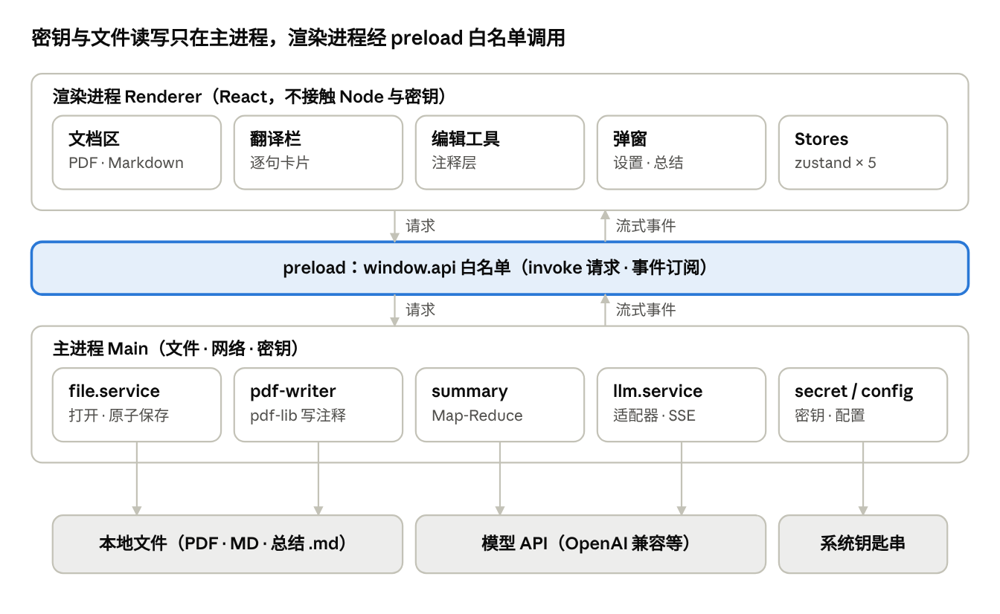
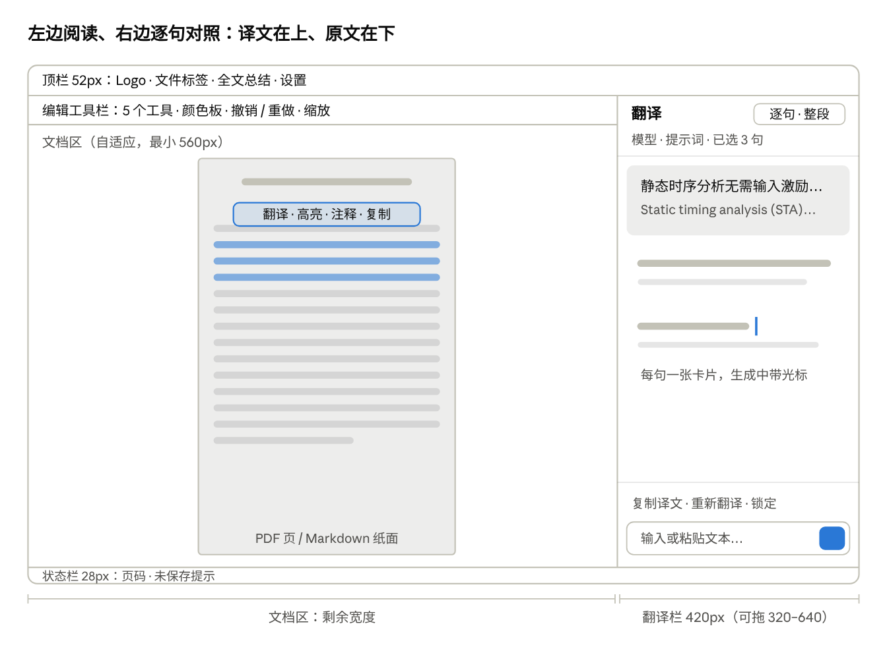
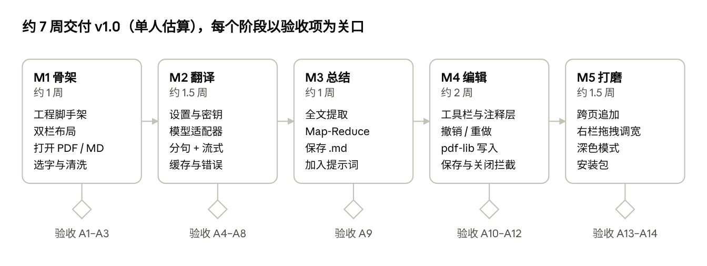

# 译读 · 开发设计文档

Oct 24, 2026 · @pph

## 1. 文档说明

本文档是「译读」v1.0 的开发设计文档：开发人员按本文从零搭建 Electron + React + TypeScript 工程，实现下面 5 项需求（R5 为 v1.0 交付后新增），并按第 15 节的验收标准自测。界面以已发布的设计画布为准，第 11～13 节写出了画布里的每一处尺寸、颜色和交互。

**产品一句话**：一个桌面端文献阅读器，左边显示 PDF / Markdown，选中文字后右边逐句显示「译文在上、原文在下」的对照翻译；翻译用用户自己配置的大模型 API。

### 1.1 需求范围（v1.0）

| 编号 | 需求 | 本文章节 |
| --- | --- | --- |
| R1 | 左侧显示并渲染 PDF、Markdown，可用鼠标选中文字；右侧显示选中文字的中文翻译，译文在上、原文在下，支持逐句对照，从上到下依次显示 | 6、7、12 |
| R2 | 可配置模型 API（API Key、model\_name 等），翻译使用该模型；可配置系统提示词，用于注入领域背景 | 8 |
| R3 | 全文自动总结：把整篇 PDF / Markdown 发给模型，生成内容提炼与报告，保存为 .md，用户选择保存位置；拿到总结后弹窗询问是否加入提示词 | 9 |
| R4 | PDF 手动编辑：工具栏提供高亮、文字背景色、文字颜色、注释；Ctrl+S 保存；关闭文件时提醒保存 | 10 |
| R5 | 没有配置 API Key 时，可用免费的机器翻译引擎（微软、谷歌）或有道智云翻译；全文总结等必须使用大模型的功能禁用 | 8.5～8.11 |

**不在 v1.0 范围内**：Markdown 编辑、OCR（扫描版 PDF）、云同步、多语言界面、移动端。

### 1.2 读者

- 前端 / Electron 开发：重点看第 3～7、10～13 节。
- 负责 LLM 接入的开发：重点看第 7～9 节。
- 测试：第 15 节。

### 1.3 术语

| 术语 | 含义 |
| --- | --- |
| 主进程 Main | Electron 的 Node.js 进程，负责窗口、文件、网络、密钥 |
| 渲染进程 Renderer | 运行 React 界面的 Chromium 页面，不能直接访问 Node |
| Preload | 在渲染进程里通过 contextBridge 暴露白名单 API 的脚本 |
| TextLayer | pdf.js 在 canvas 上叠加的一层透明文字，使 PDF 文字可被选中 |
| 句段 Sentence | 分句后的一句原文及其译文、状态 |
| 提示词预设 PromptPreset | 一份系统提示词 + 若干来自总结的背景片段 |
| 机器翻译引擎 MT | 不依赖大模型的翻译接口，如微软翻译、谷歌翻译、有道智云；不支持提示词 |
| 翻译引擎 Translator | 当前用于翻译的引擎：某个大模型配置，或某个机器翻译引擎 |
| 脏状态 dirty | 文档有未保存的编辑 |

## 2. 技术栈与依赖

选用 Electron + React + TypeScript：PDF 渲染、选字、Markdown 渲染、流式 UI 在 Web 技术栈里都有成熟方案，主进程又能直接读写文件、发 HTTP（不受 CORS 限制）。版本号按下表锁定大版本，小版本取开发时的最新稳定版。

| 包 | 版本 | 用途 | 备注 |
| --- | --- | --- | --- |
| electron | ^33 | 桌面壳 | Chromium 130，支持 `Promise.withResolvers`、`Intl.Segmenter` |
| electron-vite | ^2.3 | 主进程 / preload / 渲染进程一体化构建 | 开发时热更新 |
| electron-builder | ^25 | 打包 Windows 安装包（NSIS） | M5 再接入 |
| vite | ^5.4 | 渲染进程构建 | electron-vite 2 要求 vite 4/5 |
| react / react-dom | ^18.3 | UI |  |
| typescript | ^5.6 | 类型 | `strict: true` |
| zustand | ^5 | 状态管理 | 每个领域一个 store |
| pdfjs-dist | ^4.10 | PDF 渲染 + TextLayer 选字 + 全文提取 | worker 用 `?url` 引入 |
| pdf-lib | ^1.17 | 把注释写回 PDF | 仅在主进程使用 |
| markdown-it | ^14 | Markdown → HTML | `html: false` 防注入 |
| @vscode/markdown-it-katex + katex | ^1.1 / ^0.16 | 公式 |  |
| highlight.js | ^11 | 代码高亮 | 按需注册语言 |
| electron-store | ^8 | 配置 JSON | v9+ 为纯 ESM，遇到 CJS 问题就用 v8 |
| idb-keyval | ^6 | 翻译缓存（IndexedDB） |  |
| js-tiktoken | ^1 | token 估算 | 只用来切块，不要求精确 |
| vitest | ^2 | 单元测试 |  |
| @playwright/test | ^1.48 | Electron 端到端测试 | `_electron.launch` |

机器翻译引擎（8.5～8.11）不新增依赖：请求用 Electron `net.fetch`，有道签名用 Node 内置 `crypto`。

**不引入 UI 组件库**：界面元素少且风格统一，用 CSS Modules + 第 11 节的 CSS 变量手写，避免组件库自带的视觉风格和体积。需要 Tailwind 的团队可以用，但必须把第 11 节的 token 配到 `theme.extend` 里，不要写死色值。

**备选方案**：Tauri 2（包体小，但主进程要写 Rust）；PySide6 + PyMuPDF（改字色容易，但选字、Markdown、流式界面成本高）。v1.0 不采用。

## 3. 工程结构与脚手架

工程按 electron-vite 的三段式目录组织：`src/main`（主进程）、`src/preload`、`src/renderer`（React），另加 `src/shared` 放两边共用的类型和常量。

### 3.1 目录结构

```text
yidu/
├─ package.json
├─ electron.vite.config.ts
├─ tsconfig.json              # 渲染进程（DOM）
├─ tsconfig.node.json         # 主进程 + preload（Node）
├─ electron-builder.yml       # M5
├─ resources/                 # 应用图标
├─ tests/
│  ├─ unit/                   # vitest
│  ├─ e2e/                    # playwright
│  └─ fixtures/               # 示例 PDF / MD（单栏、双栏、含公式、大文件）
└─ src/
   ├─ shared/
   │  ├─ types.ts             # OpenedFile、ModelProfile、Annot 等
   │  └─ ipc.ts               # IPC 通道名常量 + 请求/响应类型
   ├─ main/
   │  ├─ index.ts             # 窗口、安全配置、close 拦截
   │  ├─ ipc.ts               # 注册所有 ipcMain.handle
   │  └─ services/
   │     ├─ file.service.ts    # 打开 / 保存 / 原子写入 / 最近文件
   │     ├─ config.service.ts  # electron-store
   │     ├─ secret.service.ts  # safeStorage
   │     ├─ mt/                # 机器翻译引擎（8.7）
   │     │  ├─ adapter.ts      # MtAdapter 接口
   │     │  ├─ microsoft-free.ts
   │     │  ├─ google-free.ts
   │     │  └─ youdao.ts
   │     ├─ llm/
   │     │  ├─ adapter.ts      # LLMAdapter 接口
   │     │  ├─ openai.ts       # OpenAI 兼容（含 Azure）
   │     │  ├─ anthropic.ts
   │     │  ├─ sse.ts          # SSE 解析
   │     │  └─ llm.service.ts  # 请求队列、并发、重试、取消
   │     ├─ summary.service.ts
   │     └─ pdf-writer.ts      # pdf-lib 写注释
   ├─ preload/
   │  ├─ index.ts             # contextBridge.exposeInMainWorld('api', …)
   │  └─ index.d.ts           # window.api 类型声明
   └─ renderer/
      ├─ index.html           # 含 CSP
      └─ src/
         ├─ main.tsx
         ├─ App.tsx
         ├─ styles/ (tokens.css, base.css)
         ├─ stores/ (docStore, annotStore, translateStore, settingsStore, uiStore)
         ├─ lib/
         │  ├─ textClean.ts
         │  ├─ sentenceSplit.ts
         │  ├─ streamParser.ts
         │  ├─ translateCache.ts
         │  ├─ pdfGeometry.ts     # 选区 → PDF 坐标 quads
         │  └─ shortcuts.ts
         └─ components/
            ├─ TopBar/  FileTabs/  StatusBar/
            ├─ DocumentPane/  EditToolbar/  SelectionPopover/
            ├─ PdfViewer/ (PdfViewer, PdfPage, AnnotationLayer, NotePopover)
            ├─ MarkdownViewer/
            ├─ TranslatePane/ (TranslatePane, SentenceCard, ModeSwitch, FreeInput)
            ├─ SplitPane/
            └─ dialogs/ (Modal, SettingsDialog, SummaryProgressDialog,
                         AddToPromptDialog, UnsavedChangesDialog)
```

### 3.2 搭建步骤

1. `npm create @quick-start/electron@latest yidu -- --template react-ts`（electron-vite 官方模板），或按 3.1 手建。
2. 安装依赖：`npm i pdfjs-dist pdf-lib markdown-it @vscode/markdown-it-katex katex highlight.js zustand electron-store idb-keyval js-tiktoken`；`npm i -D @types/markdown-it vitest @playwright/test`。
3. 国内网络下载 Electron 二进制慢时，设置环境变量 `ELECTRON_MIRROR=https://npmmirror.com/mirrors/electron/`。
4. 配置 `package.json` 脚本：`dev` = `electron-vite dev`，`build` = `electron-vite build`，`start` = `electron-vite preview`，`typecheck` = `tsc --noEmit -p tsconfig.node.json && tsc --noEmit -p tsconfig.json`，`test` = `vitest run`，`e2e` = `playwright test`。
5. 写 `electron.vite.config.ts`（见下）和两个 tsconfig。tsconfig 的 `lib` 至少含 `ES2022`（`Intl.Segmenter` 需要），`moduleResolution: "bundler"`。
6. 按第 4 节写主进程窗口和 preload，启动 `npm run dev` 确认窗口能打开。
7. 按第 11 节建 `tokens.css`，按第 12 节搭三栏骨架（顶栏 / 主体左右 / 状态栏）。

```ts
// electron.vite.config.ts
import { resolve } from 'path'
import { defineConfig, externalizeDepsPlugin } from 'electron-vite'
import react from '@vitejs/plugin-react'

export default defineConfig({
  main: { plugins: [externalizeDepsPlugin()] },
  preload: { plugins: [externalizeDepsPlugin()] },
  renderer: {
    resolve: { alias: { '@renderer': resolve('src/renderer/src'), '@shared': resolve('src/shared') } },
    plugins: [react()]
  }
})
```

**注意**：pdf-lib 、electron-store 只在主进程 import；pdfjs-dist、markdown-it 只在渲染进程 import。渲染进程代码不得 import `electron` 或任何 Node 内置模块。

## 4. 总体架构与 IPC 契约

所有文件读写、网络请求和密钥解密都在主进程完成；渲染进程只负责界面，通过 preload 暴露的 `window.api` 调用主进程；API Key 明文只在用户于设置页点击「显示」时按需回传一次（`secret:reveal`），用完即弃。



渲染进程的一切外部访问都要穿过中间的 preload 白名单；只有主进程触碰文件、模型接口和钥匙串。

### 4.1 进程职责

| 进程 | 负责 | 禁止 |
| --- | --- | --- |
| 主进程 | 窗口生命周期、文件对话框与读写、LLM 请求、密钥、配置、pdf-lib 写入、关闭拦截 | 执行渲染进程传来的任意路径或代码 |
| Preload | 把白名单方法挂到 `window.api`；把主进程推送的事件转成回调 | 暴露 `ipcRenderer` 本身 |
| 渲染进程 | React 界面、pdf.js 渲染、分句、注释编辑（内存态）、翻译缓存 | import `electron` / Node 模块；直接 `fetch` 模型接口 |

BrowserWindow 必须设置：`contextIsolation: true`、`nodeIntegration: false`、`sandbox: true`、`webSecurity: true`。

### 4.2 IPC 契约

通道名统一在 `src/shared/ipc.ts` 定义为常量。请求-响应用 `ipcMain.handle` / `ipcRenderer.invoke`；流式数据用主进程 `webContents.send` 推送，以 `requestId` 关联。所有入参在主进程做类型校验，校验失败直接拒绝。

| 通道 | 方向 | 入参 | 返回 / 载荷 |
| --- | --- | --- | --- |
| `file:open` | R→M | 无 | `OpenedFile \| null`（弹出打开对话框，过滤 pdf / md / markdown） |
| `file:openPath` | R→M | `{ path }` | `OpenedFile`；用于拖放和最近文件，只允许扩展名白名单 |
| `file:recent` | R→M | 无 | `RecentFile[]`（最多 10 条） |
| `pdf:save` | R→M | `{ fileId, annots: Annot[] }` | `{ ok: true } \| { ok: false, code: 'EBUSY' \| 'EPERM' \| 'UNKNOWN', message }` |
| `pdf:saveAs` | R→M | `{ fileId, annots }` | `{ ok, path? }`（弹另存为对话框） |
| `llm:translate` | R→M | `{ requestId, sentences: {id, text}[], profileId?, presetId? }` | `void`（结果走下面三个事件）；主进程按 `settings.translator` 分流到大模型或机器翻译引擎（8.8） |
| `llm:cancel` | R→M | `{ requestId }` | `void` |
| `llm:delta` | M→R | `{ requestId, sentenceId, text, replace? }` | 某句译文的增量；`replace: true` 时用 `text` 覆盖该句已有内容（机器翻译整句返回时使用） |
| `llm:done` | M→R | `{ requestId, fallback? }` | 全部完成；`fallback` 为大模型失败后改用的机器翻译引擎，此时渲染进程不把译文写入大模型的缓存（8.8） |
| `llm:error` | M→R | `{ requestId, code, message, sentenceIds? }` | 见 7.6 错误码 |
| `llm:test` | R→M | `{ profile: ModelProfileDraft }` | `{ ok, latencyMs?, code?, message? }` |
| `mt:test` | R→M | `{ engineId, appKey?, appSecret? }` | `{ ok, latencyMs?, code?, message? }`；翻译一句固定英文测试连接；`appSecret` 省略时用已保存的密钥 |
| `clipboard:read` | R→M | 无 | `string`；只允许设置页「从剪贴板识别」按钮在用户点击后调用 |
| `summary:start` | R→M | `{ jobId, fileId, text, title }` | `void` |
| `summary:progress` | M→R | `{ jobId, stage: 'extract' \| 'map' \| 'reduce', done, total }` |  |
| `summary:result` | M→R | `{ jobId, markdown, keyTerms, question }` |  |
| `summary:save` | R→M | `{ markdown, defaultName }` | `{ ok, path? }`（弹保存对话框） |
| `summary:cancel` | R→M | `{ jobId }` | `void` |
| `config:get` / `config:set` | R→M | key / patch | 配置（不含密钥） |
| `secret:set` | R→M | `{ profileId, apiKey }` | `void`；`apiKey` 为空字符串时删除该配置的密钥；有道应用密钥使用固定 `profileId = 'youdao'` |
| `secret:has` | R→M | `{ profileId }` | `boolean`；界面平时只用它判断「已配置 / 未配置」 |
| `secret:reveal` | R→M | `{ profileId }` | `string`（已保存密钥的明文，未保存为空字符串）；只允许设置页「显示」按钮调用，渲染进程不缓存 |
| `app:closeRequest` | M→R | 无 | 窗口要关闭，渲染进程开始逐个确认脏文件 |
| `app:closeConfirmed` | R→M | 无 | 全部处理完，主进程真正关闭 |

`OpenedFile = { fileId, path, name, kind: 'pdf' | 'md', bytes?: Uint8Array, text?: string, mtimeMs }`。`fileId` 由主进程生成（`crypto.randomUUID()`），并在主进程维护 `fileId → path` 映射；保存时只传 `fileId`，渲染进程无法指定任意写入路径。

### 4.3 preload 示例

```ts
// src/preload/index.ts
import { contextBridge, ipcRenderer, IpcRendererEvent } from 'electron'
import { IPC } from '../shared/ipc'

const on = <T>(ch: string, cb: (p: T) => void) => {
  const h = (_: IpcRendererEvent, p: T) => cb(p)
  ipcRenderer.on(ch, h)
  return () => ipcRenderer.removeListener(ch, h)   // 返回取消订阅函数
}

contextBridge.exposeInMainWorld('api', {
  openFile: () => ipcRenderer.invoke(IPC.FILE_OPEN),
  savePdf: (req) => ipcRenderer.invoke(IPC.PDF_SAVE, req),
  translate: (req) => ipcRenderer.invoke(IPC.LLM_TRANSLATE, req),
  cancelTranslate: (requestId: string) => ipcRenderer.invoke(IPC.LLM_CANCEL, { requestId }),
  onTranslateDelta: (cb) => on(IPC.LLM_DELTA, cb),
  onTranslateDone: (cb) => on(IPC.LLM_DONE, cb),
  onTranslateError: (cb) => on(IPC.LLM_ERROR, cb),
  // …其余通道同理
})
```

## 5. 数据模型与持久化

核心类型全部定义在 `src/shared/types.ts`，主进程和渲染进程共用；界面状态分在 5 个 zustand store 里，组件只订阅自己用到的字段。

### 5.1 核心类型

```ts
// ===== 文档 =====
export type DocKind = 'pdf' | 'md'
export interface OpenedFile {
  fileId: string; path: string; name: string; kind: DocKind
  bytes?: Uint8Array      // pdf
  text?: string           // md
  mtimeMs: number
}

// ===== 翻译 =====
export type SentenceStatus = 'pending' | 'streaming' | 'done' | 'error'
export interface Sentence {
  id: string              // `${requestId}:${index}`
  index: number           // 从 1 开始，卡片编号
  source: string          // 原文（清洗后）
  target: string          // 译文（流式累加）
  status: SentenceStatus
  error?: string
}
export type TranslateMode = 'sentence' | 'paragraph'

// ===== 模型与提示词 =====
export type Provider = 'openai-compatible' | 'anthropic' | 'azure-openai'
export interface ModelProfile {
  id: string; name: string; provider: Provider
  baseUrl: string         // https://api.openai.com/v1
  model: string           // model_name
  temperature: number     // 默认 0.2
  maxTokens?: number
  contextWindow?: number  // 上下文长度，总结切块用，默认 64000
  azureApiVersion?: string
  // 注意：没有 apiKey 字段，密钥只存在 secret.service 里
}
export interface ContextSnippet {
  id: string
  source: string          // 来源文件名，如 path_timing_ocv.pdf
  text: string
  enabled: boolean
  createdAt: string       // ISO
}
export interface PromptPreset {
  id: string; name: string        // 如「EDA 时序分析」
  systemPrompt: string
  snippets: ContextSnippet[]
}
export interface AppSettings {
  activeProfileId: string | null
  activePresetId: string | null
  summaryProfileId: string | null // 可为总结单独指定便宜模型
  targetLang: 'zh-CN'
  defaultMode: TranslateMode
  autoTranslateOnSelect: boolean  // 默认 true
  rightPaneWidth: number          // 320~640，默认 420
  zoom: number                    // 0.5~3，默认 1
  translator: Translator          // 翻译使用的引擎，见 8.6
  llmFallbackToMt: boolean        // 默认 false
}
// 机器翻译相关类型（MtEngineId、MtEngineInfo、Translator、AppConfig.mt）见 8.6

// ===== PDF 编辑 =====
export type Quad = [number, number, number, number, number, number, number, number] // PDF 坐标，左下原点
export type AnnotBase = { id: string; page: number; createdAt: string }
export type Annot =
  | (AnnotBase & { kind: 'highlight';  quads: Quad[]; color: string })
  | (AnnotBase & { kind: 'background'; quads: Quad[]; color: string; opacity: number })
  | (AnnotBase & { kind: 'textColor';  quads: Quad[]; color: string; text: string; fontSize: number })
  | (AnnotBase & { kind: 'note';       at: [number, number]; content: string; author: string })
```

### 5.2 Store 划分

| Store | 字段 | 主要动作 |
| --- | --- | --- |
| docStore | `docs: OpenedFile[]`、`activeId`、`pageCount`、`currentPage`、`zoom` | `open`、`close`、`setActive`、`setZoom` |
| annotStore | `byFile: Record<fileId, { annots, undo: Cmd[], redo: Cmd[], savedVersion, version }>`、`tool`、`color` | `add`、`update`、`remove`、`undo`、`redo`、`markSaved`、`isDirty(fileId)` |
| translateStore | `requestId`、`sentences: Sentence[]`、`mode`、`locked`、`rawSelection` | `translate(text)`、`applyDelta`、`cancel`、`retry(id)`、`setMode`、`toggleLock` |
| settingsStore | `settings: AppSettings`、`profiles`、`presets`、`mt`、`hasKey: Record<profileId, boolean>`；派生 `llmReady`、`translatorReady`（8.6） | `load`、`saveProfile`、`savePreset`、`addSnippet`、`toggleSnippet`、`setTranslator`、`ackPrivacy`、`hideFreeHint` |
| uiStore | `dialog: null \| 'settings' \| 'summaryProgress' \| 'addToPrompt' \| 'unsaved'`、`toast` | `openDialog`、`closeDialog`、`showToast` |

脏状态判定：`isDirty = version !== savedVersion`。每次执行 / 撤销 / 重做命令 `version++`（撤销回到保存点时也视为脏，实现简单且安全）。

### 5.3 持久化位置

| 数据 | 存放 | 位置 |
| --- | --- | --- |
| AppSettings、ModelProfile、PromptPreset、最近文件 | electron-store | `%APPDATA%/yidu/config.json` |
| API Key、有道应用密钥 | safeStorage 加密后的 base64 | `%APPDATA%/yidu/secrets.json`（只有密文） |
| 有道应用 ID、隐私提示确认记录 | electron-store（`AppConfig.mt`） | `%APPDATA%/yidu/config.json` |
| 翻译缓存 | IndexedDB（idb-keyval） | 渲染进程 profile，上限 5000 条，LRU 淘汰 |
| PDF 编辑 | 写回原 PDF 文件 | 用户文件本身 |
| 总结报告 | .md | 用户在保存对话框中选择 |
| 日志 | 文本日志（不记录密钥、不记录正文） | `%APPDATA%/yidu/logs/` |

首次启动时写入默认值：一个空的 OpenAI 兼容配置（`baseUrl = https://api.openai.com/v1`，`model` 为空）、一个「通用学术」提示词预设（内容见 8.3），以及 `translator = { kind: 'mt', engineId: 'microsoft-free' }`，保证没有任何密钥时也能直接翻译。

## 6. 模块一：文档阅读与选字（R1）

PDF 每页由三层叠加：canvas 画图像、TextLayer 提供可选中的透明文字、AnnotationLayer 画用户的编辑；Markdown 渲染成 HTML 后直接用浏览器原生选区。两者的选区最后都走同一个清洗 → 分句 → 翻译流程。

### 6.1 打开文件

1. 入口：顶栏 「+」按钮、`Ctrl+O`、把文件拖进窗口、空状态页的「打开文件」按钮、最近文件列表。
2. 主进程读取：PDF 返回 `Uint8Array`，Markdown 以 UTF-8 读成字符串（带 BOM 时去掉 BOM）。单文件上限 200 MB，超过拒绝并提示。
3. 同一路径已打开 → 只切换到该标签，不重复打开。
4. 标签页上限 20 个；非当前标签的 PDF 释放 canvas，只保留 `PDFDocumentProxy` 和滚动位置。

### 6.2 PDF 渲染（PdfViewer / PdfPage）

```ts
import * as pdfjs from 'pdfjs-dist'
import workerUrl from 'pdfjs-dist/build/pdf.worker.min.mjs?url'
import 'pdfjs-dist/web/pdf_viewer.css'           // 提供 .textLayer 样式
pdfjs.GlobalWorkerOptions.workerSrc = workerUrl

const task = pdfjs.getDocument({ data: bytes.slice(), isEvalSupported: false })
```

- **虚拟化**：加载后先取每页 `getViewport({ scale: 1 })` 的宽高，用占位 div 撑出整个滚动高度；每页用 `IntersectionObserver`（`rootMargin: '800px 0px'`）判断是否进入可视区附近，只渲染这些页，离开超过 3 屏的页释放 canvas。
- **清晰度**：canvas 像素尺寸 = CSS 尺寸 × `devicePixelRatio`，`render` 时传 `transform: [dpr, 0, 0, dpr, 0, 0]`。
- **TextLayer**：`new pdfjs.TextLayer({ textContentSource: page.streamTextContent(), container, viewport }).render()`。页 div 上必须设 CSS 变量 `--scale-factor`（= 当前缩放），否则文字层与图像错位。
- **选区稳定性**：TextLayer 末尾追加 `<div class="endOfContent">`，mousedown 时给文字层加 `selecting` class、mouseup 移除（与 pdf.js 官方 viewer 做法一致），避免拖到空白处时选区跳动。
- **缩放**：50%～300%，步长 10%；`Ctrl+滚轮`、`Ctrl+=` / `Ctrl+-` / `Ctrl+0`。缩放后以视口中心为锚点保持阅读位置。缩放时取消正在进行的 `renderTask`。
- **当前页**：取可视面积最大的页，写入 `docStore.currentPage`，状态栏显示「第 n / N 页」。
- **页面外观**：白底、圆角 4px、`--shadow-page`，页间距 24px，页面水平居中。

### 6.3 Markdown 渲染（MarkdownViewer）

```ts
const md = new MarkdownIt({ html: false, linkify: true, typographer: false })
  .use(katex)                     // $…$ 和 $$…$$
// highlight: (code, lang) => hljs.highlight(code, { language: lang }).value
```

- `html: false`：Markdown 里的原始 HTML 一律转义，防止脚本注入。
- 排版贴近论文：正文容器最大宽 760px，白底「纸面」与 PDF 页一致；正文 16px / 行高 1.75。
- 链接：点击由主进程 `shell.openExternal` 用系统浏览器打开（仅 http/https）；页内 `#锚点` 正常跳转。
- 图片：相对路径图片由主进程按 md 文件所在目录读取后转成 `blob:` URL（M5）；远程图片默认不加载。

### 6.4 选区捕获

1. 在文档滚动容器上监听 `mouseup` 和 `keyup`（Shift+方向键选字）。
2. 取 `window.getSelection()`；若为空、或 `anchorNode` 不在文档容器内，忽略。
3. 计算选区包围盒，在其上方 8px 居中显示 **SelectionPopover**（翻译 / 高亮 / 注释 / 复制）；上方空间不足时显示在下方。
4. 若设置 `autoTranslateOnSelect = true`（默认）且当前工具为「选择文字」、未锁定翻译栏，则防抖 300ms 后自动调用 `translateStore.translate(text)`；否则等用户点「翻译」。
5. 当前工具为高亮 / 背景色 / 文字颜色时，选中即创建对应注释（见 10.2），不自动翻译。
6. 少于 2 个字符或超过 6000 字符的选区不翻译；后者提示「选区过长，请分段选择或使用全文总结」。

### 6.5 文本清洗（lib/textClean.ts）

PDF 选出来的文字有换行、连字符、多余空格，必须先清洗再分句。按顺序执行：

| 步骤 | 规则 | 例子 |
| --- | --- | --- |
| 1 | 统一换行为 `\n`，去掉零宽字符和软连字符 `­` |  |
| 2 | 行尾连字符合并：`/(\p{L})-\s*\n\s*(\p{Ll})/gu → '$1$2'` | `trans-\nlation` → `translation` |
| 3 | 保留空行（段落边界），其余换行改为空格 |  |
| 4 | 合并连续空白为一个空格，去掉标点前的空格 | `word ,` → `word,` |
| 5 | 去掉行首行号、孤立页码（纯数字且单独成行） |  |
| 6 | 忽略连字符合并的例外：下一行首字母大写时保留连字符 | `Graph-\nBased` → `Graph-Based` |

**双栏论文**：跨栏拖选时 DOM 顺序可能与阅读顺序不同。v1.0 做法：取选区内各 span 的矩形，按「先左栏后右栏、栏内从上到下」排序后再拼接；以页面中线判断左右栏。处理不好的情况由 7.5 的「修改原文后再翻译」兜底。

**跨页追加**：SelectionPopover 在已有翻译时多一个「追加到上一段」按钮，把新选区拼到上一段原文末尾后重新分句翻译（已翻译的句子命中缓存不重发）。

## 7. 模块二：分句与逐句流式翻译（R1）

一次选区只发**一个**请求：句子编号后一起发给模型，要求按编号逐行输出，流式解析后逐句填入右栏。这样模型能看到上下文，指代和术语更一致，请求数也最少。

### 7.1 完整流程

1. `textClean(raw)` → 清洗后文本。
2. `splitSentences(text)` → `string[]`。
3. 生成 `requestId = crypto.randomUUID()`，取消上一个未完成请求（`llm:cancel`）。
4. 每句查缓存：命中则 `status = 'done'` 直接填译文；未命中 `status = 'pending'`。
5. **立即**把全部句子渲染到右栏：原文先显示，译文位置显示骨架占位条。
6. 把未命中的句子发 `llm:translate`；主进程拼 Prompt、发流式请求。当前引擎为机器翻译时改走 8.8 的分流，第 7、9 步不适用。
7. 主进程用 `StreamParser` 解析增量，按句推送 `llm:delta`；渲染进程把对应句置为 `streaming` 并追加文字，上一句置为 `done`。
8. `llm:done` → 全部置 `done`，写缓存。
9. 句数对不上或解析失败 → 对缺失的句子降级为「每句单独请求」，并发 3。

选区有多个段落（含空行）时，段落间插入分隔，右栏以 16px 间距 + 细分割线区分段落；一次最多 60 句，超出部分分批发送。

### 7.2 分句（lib/sentenceSplit.ts）

```ts
const ABBR = /\b(e\.g|i\.e|et al|etc|vs|cf|Fig|Figs|Eq|Eqs|Ref|Refs|Sec|Tab|No|Vol|pp|approx|resp|Dr|Prof|Mr|Ms)\.$/i
const seg = new Intl.Segmenter('en', { granularity: 'sentence' })

export function splitSentences(text: string): string[] {
  const raw = [...seg.segment(text)].map(s => s.segment.trim()).filter(Boolean)
  const out: string[] = []
  for (const s of raw) {
    const prev = out.at(-1)
    const mustMerge = prev && (
      ABBR.test(prev) ||                 // 上一段以缩写结尾
      /^[a-z0-9(\[]/.test(s) ||          // 本段小写/数字/括号开头
      /\d\.$/.test(prev) && /^\d/.test(s) || // 小数被切开
      s.length < 12                      // 过短片段
    )
    if (mustMerge) out[out.length - 1] = `${prev} ${s}`
    else out.push(s)
  }
  return out
}
```

中文原文（中译英以后版本）用 `new Intl.Segmenter('zh', …)`，按「。！？」切分即可。分句函数必须有单元测试，用例见 15.1。

### 7.3 Prompt 构造

最终发送的消息：

```text
[system]
{用户的系统提示词}

## 文献背景（来自总结）
{已启用的 snippet 1}
{已启用的 snippet 2}

## 输出格式（必须遵守）
将用户给出的编号句子逐句翻译为简体中文。
每句一行，格式为 "[编号] 译文"，编号与输入一一对应，不要合并、拆分或省略句子。
只输出译文，不要解释、不要重复原文。公式、变量名、引用编号原样保留。

[user]
[1] Static timing analysis (STA) verifies that ...
[2] However, as process nodes shrink, ...
[3] In this work, we propose ...
```

用户提示词为空时，用内置默认（见 8.3）。「输出格式」部分由程序固定追加，用户不可编辑，保证解析可靠。

### 7.4 流式解析器（streamParser.ts，主进程）

- 维护缓冲区 `buf` 和当前句号 `cur`。每收到一段 token 追加到 `buf`。
- 用 `/(?:^|\n)\s*\[(\d+)\]\s*/g` 找编号标记：遇到新标记 → 把标记前的文字作为 `cur` 句的增量发出，`cur` 切到新号。
- `buf` 末尾若可能是未完整的标记（如 `\n[1`），保留到下一次再判断，其余文字立即作为增量发出，保证「一个字一个字长出来」。
- 增量推送节流：同一句每 50ms 最多推一次，减少 IPC 和 React 重渲染。
- 结束后校验：编号集合 ≠ 输入集合 → 缺失的句子走降级。

### 7.5 右栏交互

- **逐句 / 整段切换**：同一份 `sentences` 数据。整段模式把译文拼成一段在上、原文拼成一段在下，中间一条分割线。
- **悬停联动**：鼠标悬停某句卡片时，卡片底色变为 `--bg-hover`；（M5）PDF 中对应原文加浅色描边。
- **卡片操作**（悬停时右上角出现）：复制本句译文、重新翻译本句、编辑原文后再翻译（原文变成可编辑文本框，`Enter` 提交、`Esc` 取消）。
- **底部操作**：复制译文（全部句子，按顺序用空格连接）、重新翻译（跳过缓存）、锁定（锁定后新的选区不再覆盖右栏，按钮高亮，用于精读时查单词）。
- **输入翻译**：底部输入框 `Enter` 提交、`Shift+Enter` 换行，走同一套分句翻译流程。
- **自动滚动**：生成中的句子超出可视区时自动滚到可见；用户手动向上滚动后暂停自动滚动，直到下一次选区。

### 7.6 缓存与错误

**缓存 key** = `sha256(source + '\u0000' + engineKey)`。大模型的 `engineKey` = `'llm:' + profileId + model + '\u0000' + promptHash`，其中 `promptHash` 是系统提示词 + 已启用 snippet 的哈希，修改提示词后旧缓存自然失效；机器翻译的 `engineKey` = `'mt:' + engineId`。切换引擎后不会命中其他引擎的译文。

机器翻译新增的 `ENGINE_UNAVAILABLE`、`QUOTA` 两个错误码见 8.8。

| 错误码 | 触发 | 右栏显示 | 动作按钮 |
| --- | --- | --- | --- |
| `NO_PROFILE` | 当前翻译引擎未配置好：大模型没有密钥，或有道缺少应用 ID / 应用密钥 | 「当前翻译引擎还没有配置好」 | 去设置 · 改用微软翻译（免费） |
| `AUTH` | HTTP 401 / 403 | 「API Key 无效或无权限」 | 去设置 |
| `MODEL_NOT_FOUND` | HTTP 404 或模型不存在 | 「找不到模型 {model}」 | 去设置 |
| `RATE_LIMIT` | HTTP 429 | 「请求太频繁，稍后重试」 | 重试 |
| `CONTEXT_TOO_LONG` | 上下文超长 | 「选区太长」 | — |
| `NETWORK` / `TIMEOUT` | 网络失败 / 60s 无响应 | 「网络连接失败」 | 重试 |
| `SERVER` | HTTP 5xx | 「模型服务异常」 | 重试 |

429 / 5xx / 网络错误自动重试 2 次，指数退避 1s、2s；已经开始输出后中断的，只对未完成的句子重试。错误以卡片内红色小字 + 按钮的形式显示，不弹窗。

## 8. 模块三：翻译引擎、模型 API 与系统提示词（R2、R5）

用户可以保存多个模型配置和多个提示词预设，各选一个为当前使用；所有模型调用都经过主进程的同一个 `LLMAdapter` 接口，OpenAI 兼容格式即可覆盖大多数服务（DeepSeek、通义千问、智谱、Moonshot、本地 Ollama 等都提供兼容接口）。没有配置大模型的用户可以改用机器翻译引擎（8.5～8.11），翻译照常可用，只有全文总结等必须依赖大模型的功能被禁用。

### 8.1 适配器接口

```ts
export interface ChatMessage { role: 'system' | 'user' | 'assistant'; content: string }
export interface ChatOptions { temperature: number; maxTokens?: number; signal: AbortSignal }
export interface LLMAdapter {
  chatStream(messages: ChatMessage[], opts: ChatOptions): AsyncIterable<string> // 逐段产出文字
  chat(messages: ChatMessage[], opts: ChatOptions): Promise<string>              // 非流式，总结 Map 阶段用
}
```

| provider | 请求 | 头 | 流式字段 |
| --- | --- | --- | --- |
| openai-compatible | `POST {baseUrl}/chat/completions`，`stream: true` | `Authorization: Bearer {key}` | `choices[0].delta.content`，`data: [DONE]` 结束 |
| azure-openai | `POST {baseUrl}/openai/deployments/{model}/chat/completions?api-version={v}` | `api-key: {key}` | 同上 |
| anthropic | `POST {baseUrl}/v1/messages`，`stream: true`，system 单独字段 | `x-api-key`、`anthropic-version: 2023-06-01` | `content_block_delta` 事件的 `delta.text` |

- 主进程用 Electron 的 `net.fetch` 发请求（走 Chromium 网络栈，自动遵守系统代理，对国内用户访问海外接口很重要），用返回的 `ReadableStream` 解析 SSE：按 `\n\n` 切事件，取 `data:` 行。
- `baseUrl` 自动去掉末尾 `/`；用户填了完整的 `/chat/completions` 时不重复拼接。
- 并发上限：同一 profile 同时最多 3 个请求，其余排队；每个请求持有 `AbortController`，`llm:cancel` 时 abort。
- 超时：首字 30s、两段增量间隔 60s。

### 8.2 设置弹窗 · 「模型 API」标签页

| 字段 | 控件 | 校验 / 默认值 |
| --- | --- | --- |
| 配置切换 | 标签页内顶部下拉 + 「新建」「删除」 | 至少保留一个 |
| 接口类型 | 下拉：OpenAI 兼容接口（推荐）/ Anthropic Messages / Azure OpenAI | 切换时按类型填入 Base URL 默认值 |
| Base URL | 文本框 | 必须是 `https://`；`http://` 只允许 localhost / 127.0.0.1（本地模型） |
| API Key | 密码框 + 「显示 / 隐藏」按钮 | 已保存时输入框为空、占位显示 `••••••••`，只有用户重新输入才覆盖；点「显示」调用 `secret:reveal` 以明文显示已保存密钥，再点「隐藏」恢复密码框并清除明文，切换配置或关闭设置时同样清除，查看不算修改；下方小字「密钥加密保存在本机系统钥匙串中，不会写入配置文件。」 |
| 模型名称 | 文本框，placeholder「例如 gpt-4o-mini」 | 必填 |
| Temperature | 数字框 | 0～2，默认 0.2 |
| 测试连接 | 次要按钮 + 结果文字 | 发一条 `max_tokens: 5` 的请求；成功显示绿色对勾 +「连接正常，响应 {n} ms」，失败按 7.6 错误码显示红字 |

底部「取消」「保存」：保存时先 `secret:set`（如果密钥有改动），再 `config:set`。有未保存改动时点取消 / 关闭 / Esc，弹二次确认「放弃对设置的修改？」。

### 8.3 设置弹窗 · 「系统提示词」标签页

- **预设下拉**（右上）：切换 / 新建 / 重命名 / 删除预设。
- **领域背景 / 系统提示词**：多行文本框，默认 9 行可纵向拉伸，右下角显示估算 token 数；超过 2000 token 时文字变为警示色并提示「提示词较长，会增加每次翻译的费用」。
- **来自文章总结的背景**：列表，每条一个卡片（文件图标 + 「{文件名} 的总结」+ 两行摘要 + 「启用」复选框 + 悬停时出现的「查看 / 删除」）；下方说明「启用的背景会追加在系统提示词之后，一起发送给模型。」。空列表时显示「还没有背景。用「全文总结」生成后可以加入这里。」

内置「通用学术」预设：

```text
你是专业的学术论文译者。请将英文学术文本翻译为准确、通顺、符合中文学术习惯的简体中文。
- 术语使用学科内通用译法，专有缩写首次出现时保留英文，如“卷积神经网络（CNN）”。
- 保持原文的逻辑关系和语气，不增删信息。
```

界面示例中的「EDA 时序分析」预设（可作为第二个内置示例）：

```text
你是集成电路 EDA 领域的专业译者。请将用户给出的英文学术文本翻译为准确、通顺的简体中文。
- 术语保持行业惯用译法：setup/hold → 建立/保持时间，slack → 时序裕量，OCV → 片上偏差。
- 专有缩写首次出现时保留英文，如“静态时序分析（STA）”。
- 不要添加解释，只输出译文。
```

### 8.4 翻译栏快速切换

翻译栏头部的两个小标签可点击：

- **翻译引擎标签**（状态圆点 + 引擎名）：下拉分两组，「大模型」列出已保存的模型配置，「机器翻译」列出微软翻译（免费）、谷歌翻译（免费）、有道智云。选中即写入 `settings.translator`（选大模型时同时写 `activeProfileId`）。圆点颜色：可用为 `--accent`，未配置密钥为灰色，最近一次请求失败为 `--danger`。
- **提示词标签**（「提示词：{预设名}」）：弹出预设列表。当前引擎为机器翻译时置灰（`disabled`），悬停提示「机器翻译引擎不支持提示词」。

切换后不自动重译当前内容，由用户点「重新翻译」。

### 8.5 机器翻译引擎概述（R5）

没有 API Key 的用户默认使用**微软翻译（免费）**，装好软件、选中文字即可翻译。引擎组合如下：

| 引擎 id | 名称 | 需要密钥 | 国内直连 | 接口性质 | 默认 |
| --- | --- | --- | --- | --- | --- |
| `microsoft-free` | 微软翻译（免费） | 否 | 可以 | 非官方：Bing 网页翻译接口 `ttranslatev3`（原 Edge 内置翻译的免密钥 token 接口已于 2026 年 8 月前后下线） | 没有可用大模型时的默认引擎 |
| `google-free` | 谷歌翻译（免费） | 否 | 不可以，需系统代理 | 非官方：网页端 `client=gtx` 接口 | — |
| `youdao` | 有道智云 | 是：应用 ID + 应用密钥 | 可以 | 官方 API，按字符计费，新用户有体验额度 | — |
| 大模型 | 现有模型配置 | 是 | 视服务而定 | 官方 API | 已保存密钥时的默认引擎 |

- 两个免费引擎是非官方接口，可能限流或随时失效，因此必须有明确的错误提示和一键切换（8.8）。
- **不采用**的方案：免密钥的有道网页接口（需逆向签名、响应加密，改版即失效）；代用户注册、代收手机验证码、微信扫码获取密钥（违反平台条款，实名认证无法代办，且涉及敏感个人信息）。需要密钥的引擎一律采用引导式配置（8.10）。
- 机器翻译**支持**：逐句 / 整段、输入翻译、重译、编辑原文后重译、缓存。**不支持**：系统提示词与总结背景、流式逐字输出（整句一次返回）。
- 类型上预留 `yidu-cloud`（以后自建翻译服务，用户登录后使用服务端额度），本期不实现。

### 8.6 数据模型与配置迁移

```ts
// src/shared/mt.ts
export type MtEngineId = 'microsoft-free' | 'google-free' | 'youdao' // 以后增加 'yidu-cloud'
export interface MtEngineInfo {
  id: MtEngineId
  name: string                  // 「微软翻译（免费）」
  requiresKey: boolean
  needsProxyInChina: boolean
  provider: string              // 隐私提示中的服务方：「微软」「谷歌」「有道」
  hosts: readonly string[]      // 允许请求的域名白名单
  signupUrl?: string            // 「如何获取？」打开的官方页面
}
export const MT_ENGINES: readonly MtEngineInfo[] // 内置元数据，不写入配置

// src/shared/types.ts
export type Translator = { kind: 'llm' } | { kind: 'mt'; engineId: MtEngineId }
export interface AppSettings {
  // …原有字段
  translator: Translator        // 翻译使用的引擎；kind 为 'llm' 时使用 activeProfileId
  llmFallbackToMt: boolean      // 默认 false：大模型请求失败时改用 microsoft-free
}
export interface AppConfig {
  // …原有字段
  mt: {
    youdaoAppKey: string        // 有道「应用 ID」，非机密，存配置
    privacyAcked: MtEngineId[]  // 已确认过隐私提示的引擎
    hideFreeHint: boolean       // 已关闭翻译栏底部的免费引擎提示
  }
}
```

- 有道「应用密钥」通过现有 `secret:set` / `secret:has` / `secret:reveal` 加密保存，`profileId` 固定为 `'youdao'`。模型配置的 id 是 UUID，不会冲突。
- **配置迁移**（主进程 config.service 读取配置时执行）：没有 `translator` 字段的旧配置，若 `activeProfileId` 对应的模型已保存密钥 → `{ kind: 'llm' }`，否则 → `{ kind: 'mt', engineId: 'microsoft-free' }`；`mt` 缺失时写入默认值 `{ youdaoAppKey: '', privacyAcked: [], hideFreeHint: false }`。
- **配置校验**：`engineId` 不在 `MT_ENGINES` 中时回退到 `microsoft-free`。
- `summaryProfileId` 为 `null` 时表示「使用当前大模型」（`activeProfileId`），与当前翻译引擎无关。
- 渲染进程派生两个状态（settingsStore）：
    - `llmReady` = 总结所用模型（`summaryProfileId ?? activeProfileId`）存在且已保存密钥。
    - `translatorReady` = 免费引擎恒为 true；有道需应用 ID 和应用密钥都已保存；大模型需已保存密钥。

### 8.7 适配器与请求

```ts
// src/main/services/mt/adapter.ts
export interface MtAdapter {
  /** 返回数组与输入一一对应；失败时抛出带错误码的 TranslateError */
  translate(texts: string[], opts: { signal: AbortSignal }): Promise<string[]>
}
```

| 引擎 | 请求 | 分批与对齐 | 目标语言 |
| --- | --- | --- | --- |
| `microsoft-free` | 先 `GET {站点}/translator`，从页面解析 `params_AbusePreventionHelper = [key, "token", interval]`、`IG:"…"`、`data-iid="translator.xxxx"`（缓存到 token 过期，最长 50 分钟）；再 `POST {站点}/ttranslatev3?isVertical=1&IG={IG}&IID={IID}.{序号}`，表单 `fromLang=auto-detect, to=zh-Hans, text, token, key`，响应取 `[0].translations[0].text`。返回错误对象或验证码时重新取一次页面参数再试 | 每次请求不超过 1000 字符；多句以空行 `\n\n` 连接，按空行切回，数量对不上时逐句请求（并发 2） | `zh-Hans` |
| `google-free` | `POST https://translate.googleapis.com/translate_a/single?client=gtx&sl=auto&tl=zh-CN&dt=t`，表单体 `q=句子以 \n 连接` | 每批不超过 5000 字符；把响应 `data[0]` 各段译文拼接后按 `\n` 切回句子；数量对不上时改为逐句请求，并发 3 | `zh-CN` |
| `youdao` | `POST https://openapi.youdao.com/api`，表单 `q, from=auto, to=zh-CHS, appKey, salt, curtime, signType=v3, sign` | 逐句请求，并发 3 | `zh-CHS` |

- 有道签名：`sign = sha256(appKey + input + salt + curtime + appSecret)`，其中 `input` = `q` 长度 ≤ 20 时为 `q` 本身，否则为「前 10 个字符 + 长度 + 后 10 个字符」；`salt` 用 `crypto.randomUUID()`，`curtime` 为秒级时间戳。以有道智云官方文档为准。
- Bing 网页接口的特殊处理：请求使用独立的内存会话 `session.fromPartition('yidu-mt-bing')`（cookie 不进入应用默认会话、不落盘），并把该会话的 User-Agent 设为普通 Chrome（网页接口会拒绝带 Electron 标识的 UA）。国内访问 `www.bing.com` 会重定向到 `cn.bing.com`，而 Electron 的 fetch 既不提供重定向后的地址、也不支持 `redirect: 'manual'`，因此**不跟随重定向**，依次尝试 www → cn 两个站点，用成功的那个完成页面与翻译请求，并记住它供下次优先使用。
- 所有请求在主进程用 `net.fetch` 发出（遵守系统代理）；请求地址只能是 `MtEngineInfo.hosts` 中的域名，不接受用户自定义地址。
- 超时 15 秒；每个引擎同时最多 3 个请求；单句超过 5000 字符时拒绝并提示「句子过长」。
- 测试专用：环境变量 `YIDU_MT_BASE_MICROSOFT` / `YIDU_MT_BASE_GOOGLE` / `YIDU_MT_BASE_YOUDAO` 可把对应引擎地址指向本地 mock 服务，**仅在 `!app.isPackaged` 时生效**。
- 不新增第三方依赖：sha256 用 Node 内置 `crypto`。

### 8.8 翻译分流、回退与错误

- 渲染进程仍调用 `llm:translate`。主进程 `LLMService.translate` 读取 `settings.translator`：`llm` 走现有流式逻辑（7.1～7.4）；`mt` 调用对应 `MtAdapter.translate(未命中缓存的句子)`，结果按句各发一次 `llm:delta`（整句，`replace: true`）后发 `llm:done`。右栏逐句卡片与整段切换无需改动。
- 机器翻译不拼 Prompt，系统提示词和总结背景不参与请求。
- **回退**：`llmFallbackToMt` 开启且大模型请求最终失败（`NETWORK` / `TIMEOUT` / `SERVER`，或重试后仍 `RATE_LIMIT`）时，对未完成的句子改用 `microsoft-free` 重试，并 Toast「大模型请求失败，已改用微软翻译」。`AUTH`、`MODEL_NOT_FOUND` 等配置错误不回退，直接提示用户修正。
- **缓存 key** 加入引擎标识，切换引擎后不会命中旧译文（见 7.6）。
- **错误码**：在 7.6 基础上新增两个：

| 错误码 | 触发 | 右栏显示 | 动作按钮 |
| --- | --- | --- | --- |
| `ENGINE_UNAVAILABLE` | 免费接口失效、网络不通、返回格式无法解析、Bing 页面参数解析失败或重新获取后仍返回错误 | 「谷歌翻译不可用（可能需要代理）」/「微软翻译暂时不可用」 | 切换到微软翻译（当前已是微软时为「切换到谷歌翻译」）· 重试 |
| `QUOTA` | 有道账户余额不足（错误码 401） | 「有道智云账户余额不足」 | 打开有道控制台 |

有道错误码映射（以官方错误码文档为准）：`108` → `AUTH`「应用 ID 无效」；`202` → `AUTH`「签名校验失败，请检查应用密钥」；`110` → `AUTH`「应用未绑定文本翻译服务」；`401` → `QUOTA`；`411` → `RATE_LIMIT`；其他 → `SERVER`，附原始错误码。微软、谷歌的 HTTP 429 → `RATE_LIMIT`，按 7.6 自动重试。

### 8.9 功能开关

| 功能 | 当前引擎为机器翻译时 | `llmReady` 为 false 时 |
| --- | --- | --- |
| 逐句 / 整段翻译、输入翻译、重译、编辑原文 | 正常 | 正常（走机器翻译） |
| 系统提示词、总结背景 | 不参与请求；翻译栏提示词标签置灰 | 同左 |
| 全文总结（顶栏按钮、`Ctrl+Shift+M`） | 取决于 `llmReady` | 按钮置灰，悬停提示「全文总结需要配置大模型 API」；点击或按快捷键时打开设置的「模型 API」标签页 |
| 加入提示词弹窗 | 不受影响 | 不会出现（总结不可用） |

### 8.10 设置弹窗 ·「翻译引擎」标签页

设置弹窗的标签页变为：**翻译引擎** · 模型 API · 系统提示词 · 翻译偏好，打开设置时默认停在「翻译引擎」。

- **「翻译时使用」单选卡片组**（`role="radiogroup"`，卡片间距 8px）：每张卡片 1px `--border-input`、圆角 10px、内边距 14px 16px；选中时描边 `--accent`、底色 `--accent-soft`。卡片内容：
    - 第一行：引擎名（13px/600）+ 状态标签（高 20px、内边距 0 6px、圆角 6px、11px）：「免费」（`--bg-subtle` 底）、「需代理」（`--warn-soft` 底 `--warn-ink` 字）、「需密钥」/「已配置」（后者 `--accent-soft` 底 `--accent-ink` 字）。
    - 第二行：一句说明（12px `--text-secondary`），如「无需配置，国内可直接使用」「国内需要开启系统代理」「官方接口，稳定，需注册获取密钥」。
    - 右侧：「测试连接」次按钮（高 30px）+ 结果文字，规则同 8.2。
- **大模型卡片**：显示当前模型配置名；未保存密钥时显示「未配置」和文字按钮「前往「模型 API」配置」（切换到该标签页）。
- **有道智云卡片**：选中或尚未配置时展开以下字段：
    - 应用 ID（文本框）、应用密钥（密码框 +「显示 / 隐藏」，行为同 8.2 的 API Key，读取用 `secret:reveal`，`profileId = 'youdao'`）。
    - 「如何获取？」：`<a target="_blank">` 链接，由主进程交给系统浏览器打开有道智云官网；卡片内同时显示步骤说明框（`--bg-muted` 底、圆角 10px、内边距 12px 14px、12px/1.7）：
        1. 打开有道智云 AI 开放平台，用手机号注册并登录
        2. 完成实名认证
        3. 在控制台创建应用，接入方式选「API」
        4. 给应用绑定「文本翻译」服务
        5. 复制「应用 ID」和「应用密钥」，粘贴到下方
    - 「从剪贴板识别」按钮：**用户点击后**才经 `clipboard:read` 读取剪贴板，识别疑似应用 ID（通常为 16 位十六进制）和应用密钥（通常为 32 位字母数字），弹出确认「识别到应用 ID ab12…ef34 和应用密钥 ••••，是否填入？」，确认后填入并自动测试连接。不主动、不定时读取剪贴板。
    - 测试连接失败时显示 8.8 映射后的中文原因，而不只是错误码。
- **底部开关**：「大模型请求失败时改用微软翻译（免费）」，对应 `llmFallbackToMt`。
- 保存规则同 8.2：点「保存」时先保存有改动的应用密钥（`secret:set`），再保存配置。

### 8.11 隐私提示与免费引擎提示

- **隐私提示**：第一次用某个免费引擎翻译时（包括首次启动后的默认微软翻译），在发出请求前弹出小弹窗：标题「使用{引擎名}翻译」，正文「选中的文字会发送到{服务方}的服务器进行翻译。免费引擎为非官方接口，可能不稳定，可以随时在设置中更换。」，按钮「取消」·「继续使用」。选「继续使用」后把引擎 id 写入 `mt.privacyAcked`，以后不再提示；选「取消」则本次不发送请求，卡片显示「已取消，可在设置中更换翻译引擎」。
- **免费引擎提示**：当前引擎为免费引擎且 `mt.hideFreeHint` 为 false 时，翻译栏底部操作行上方显示一行 12px `--text-secondary` 文字「正在使用免费引擎，配置大模型术语更准确」（须在 420px 宽的翻译栏中保持一行）+ 文字按钮「去配置」（打开设置的「模型 API」标签页）+ 16px 关闭图标；关闭后写入 `mt.hideFreeHint = true`。

## 9. 模块四：全文自动总结（R3）

点「全文总结」后提取当前文档全文，短文一次请求完成，长文先分块提炼再合并（Map-Reduce）；生成后弹保存对话框写成 .md，保存成功后弹窗询问是否加入提示词。

### 9.1 流程

1. **开始前确认**：估算全文 token 和请求次数，若全文 > 30k token，先弹轻量确认「全文约 {n} 万 token，预计请求 {k} 次，继续？」。
2. **提取**（stage `extract`）：PDF 逐页 `page.getTextContent()`，按 `hasEOL` 拼行后走 6.5 清洗；在每页开头插入 `<<PAGE n>>` 标记便于引用。Markdown 直接用源文本。全文有效字符 < 200 时提示「未提取到文字，可能是扫描版 PDF」并终止。
3. **分支**：全文 token ≤ 模型上下文 × 0.6（上下文长度在模型配置中可填，默认按 64k）→ 直接走 Reduce 模板一次生成。
4. **Map**：按标题 / 空行切块，每块 ≤ 4000 token，相邻块重叠最后一段；并发 3 调用 `chat()`，每块输出要点（≤ 300 字）。进度 `map done/total`。
5. **Reduce**：把所有要点按顺序拼接，用报告模板生成最终 Markdown（流式，弹窗中可以展开实时预览）。
6. **保存**：`summary:save` 弹 `dialog.showSaveDialog`，默认目录 = 源文件所在目录，默认文件名 `{源文件名}_总结.md`，过滤器 `Markdown (*.md)`；UTF-8 无 BOM 写入。用户取消保存 → 弹窗提示「总结尚未保存」并提供「重新选择位置」「放弃」。
7. **询问加入提示词**：保存成功后弹 AddToPromptDialog（见 12.9）。选「加入提示词」→ 当前预设新增一条 `ContextSnippet`（`enabled: true`）；若勾选了「只加入关键术语和研究问题」，只取报告里的这两节。同一文件已有 snippet 时询问「替换 / 保留两份」。

整个过程可以在进度弹窗点「取消」中止（`summary:cancel` → abort 所有子请求）。总结使用 `summaryProfileId` 指定的模型，未指定则用当前大模型（`activeProfileId`），与当前翻译引擎无关；`llmReady` 为 false 时总结不可用（8.9）。

### 9.2 Map 提示词

```text
[system] 你是严谨的科研助理。阅读下面这段论文片段（第 {i}/{N} 块），用简体中文列出其中的要点：
研究问题、方法细节、实验设置与结果数字、出现的专业术语（英文原词）。只写片段中有的信息，不要推测，不超过 300 字。
[user] {片段文本}
```

### 9.3 Reduce 报告模板

```text
[system] 你是严谨的科研助理。根据下面的论文要点（或全文），用简体中文写一份阅读报告，严格使用以下 Markdown 结构，不要增减一级标题：

# 《{论文标题}》阅读总结
## 一句话概括
## 研究问题与动机
## 方法
## 实验与结论
## 关键术语
（表格：英文 | 中文 | 一句话解释）
## 局限与可追问的问题

只依据给出的内容，数字保持原样，不要编造。
[user] {要点合集或全文}
```

生成后程序按 `## 关键术语` 和 `## 研究问题与动机` 标题切出两段，作为 `keyTerms`、`question` 返回；标题缺失时加入提示词用全文。报告末尾由程序追加元信息：源文件名、生成时间、模型名。

## 10. 模块五：PDF 编辑与保存（R4）

编辑先存在内存里（`annotStore`），由渲染进程的 AnnotationLayer 即时画出；只有按 `Ctrl+S` 时才由主进程用 pdf-lib 写成标准 PDF 注释，写回原文件。标准注释在 Acrobat、浏览器、知云等阅读器里都能看到。

### 10.1 工具栏（EditToolbar）

| 工具 | 图标含义 | 用法 | 生成 |
| --- | --- | --- | --- |
| 选择文字（默认） | I 形光标 + 文字行 | 选中即翻译 | — |
| 高亮 | 荧光笔 | 拖选文字松开即创建 | `highlight` |
| 背景色 | 带 A 字的方块 | 同上，可调透明度（默认 0.35） | `background` |
| 文字颜色 | A + 下划线 | 同上 | `textColor` |
| 注释 | 对话气泡 | 在页面任意处单击放置便签，立即弹出输入框；或先选中文字再点「注释」，便签放在选区右侧页边 | `note` |

- 颜色板 5 色：黄 `#FDE68A`、绿 `#BBF7D0`、蓝 `#BFDBFE`、粉 `#FBCFE8`、红 `#B42318`（前 4 色用于高亮 / 背景、红色主要用于文字颜色）。每个工具记住各自上次用的颜色。
- 工具快捷键：`V` 选择、`H` 高亮、`B` 背景色、`T` 文字颜色、`N` 注释、`Esc` 回到选择（焦点在输入框内时不生效）。
- 撤销 `Ctrl+Z`、重做 `Ctrl+Y` / `Ctrl+Shift+Z`，按文件分别维护。
- Markdown 文件打开时，编辑工具置灰（`disabled` + tooltip「仅 PDF 支持编辑」），缩放控件保留。

### 10.2 选区 → PDF 坐标（lib/pdfGeometry.ts）

1. `range.getClientRects()` 取选区的各行矩形；按所属页 div 分组（跨页选区拆成多条注释）。
2. 同一行相邻矩形合并（垂直重叠 > 50% 且水平间距 < 2px）。
3. 屏幕坐标 → 页内 CSS 坐标 → `viewport.convertToPdfPoint(x, y)` 得到 PDF 坐标（左下原点）。
4. 每个矩形转成 QuadPoints，顺序为 **左上、右上、左下、右下**（各阅读器实际兼容的顺序，与规范描述不同，务必遵守）。
5. `textColor` 额外记录选中文字 `text` 和字号（取 TextLayer span 的 font-size ÷ 缩放）。

坐标全部以 PDF 坐标存储，与缩放无关；AnnotationLayer 绘制时用 `viewport.convertToViewportPoint` 反算。

### 10.3 屏幕上的绘制（AnnotationLayer）

- 每页一个绝对定位的 SVG，位于 canvas 之上、TextLayer **之下**（`z-index` canvas 0 / annot 1 / text 2），保证注释不挡住选字。
- highlight / background：`<rect>` 填充颜色，`mix-blend-mode: multiply`，高亮不透明度 0.55、背景色按设定。
- textColor：先画白色矩形遮住原字，再用目标颜色的 `<text>` 重绘同样的文字（字体 Source Serif 4 / Times 近似）。
- note：页边 22×22 黄色圆角方块（`#FDE68A` 底、`#92400E` 图标），点击弹出 NotePopover（见 12.4）。
- 点击已有注释（在「选择文字」工具下）弹出小菜单：改颜色 / 删除；删除也进入 undo 栈。

### 10.4 写入 PDF（pdf-writer.ts，主进程）

| Annot | PDF 注释字典 |
| --- | --- |
| highlight | `/Subtype /Highlight`、`/QuadPoints`、`/C [r g b]`、`/CA 0.55`、`/Rect`（quads 外接矩形）、`/F 4`（Print） |
| background | 同上，`/CA` = 设定透明度；`/NM` 前缀 `yidu-bg-` 便于区分 |
| textColor | `/Subtype /FreeText`，`/Rect` = 文字外接矩形，`/DA (/Helv {size} Tf {r g b} rg)`，并**生成外观流 `/AP /N`**：白色填充矩形 + 目标色文字，无边框 |
| note | `/Subtype /Text`、`/Name /Comment`、`/Contents`、`/T`（作者）、`/M`（修改时间）、`/C` 黄色 |

- 所有注释写 `/NM (yidu-{id})`。保存时先删除文件中所有 `/NM` 以 `yidu-` 开头的注释，再写入当前全部注释，实现幂等保存。
- 打开已有的 PDF 时用 pdf.js `page.getAnnotations()` 读回带 `yidu-` 前缀的注释，反序列化到 annotStore，实现「关闭再打开还能继续编辑」；其他软件创建的注释由 pdf.js 的原生注释层只读显示。
- 中文便签内容：`/Contents` 用 UTF-16BE 加 BOM 的 PDF 字符串（pdf-lib `PDFHexString.fromText`）。
- 加密 / 禁止修改的 PDF：打开时检测，工具栏置灰并提示「该 PDF 受保护，只能阅读」。

### 10.5 保存（Ctrl+S）

1. 渲染进程捕获 `Ctrl+S`（应用菜单加加速键同样触发），若当前文档不脏则什么都不做。
2. `pdf:save { fileId, annots }` → 主进程读**磁盘上的原文件**（不用渲染进程的内存副本），校验 `mtimeMs` 与打开时一致；不一致弹「文件已被其他程序修改，覆盖 / 另存为 / 取消」。
3. pdf-lib 写入注释 → `save()` → 写到同目录 `{name}.yidu-tmp` → `fs.rename` 覆盖原文件（原子替换，写一半崩溃不会损坏原文件）。
4. Windows 上原文件被其他程序占用（`EBUSY` / `EPERM`）→ 返回错误，弹「文件正被其他程序使用，请关闭后重试，或另存为」。
5. 成功 → 更新 `mtimeMs`、`annotStore.markSaved(fileId)`，标签小圆点消失，底部弹轻提示「已保存」（2s 后消失）。
6. `Ctrl+Shift+S` = 另存为；另存后标签指向新文件。

### 10.6 关闭拦截

**关闭标签**（标签 ×、`Ctrl+W`、中键点击标签）：脏 → 弹 UnsavedChangesDialog：「保存」先保存成功再关闭（失败则不关）；「不保存」直接关闭并丢弃编辑；「取消」什么都不做。

**关闭窗口 / 退出应用**：

```ts
// main/index.ts
let allowClose = false
win.on('close', (e) => {
  if (allowClose) return
  e.preventDefault()
  win.webContents.send(IPC.APP_CLOSE_REQUEST)   // 渲染进程逐个处理脏文件
})
ipcMain.handle(IPC.APP_CLOSE_CONFIRMED, () => { allowClose = true; win.close() })
```

渲染进程收到 `app:closeRequest` 后按标签顺序对每个脏文件弹一次 UnsavedChangesDialog（先切换到该标签）；任一步选「取消」则中止关闭；全部处理完调 `app:closeConfirmed`。渲染进程崩溃或 5s 无响应时主进程用系统对话框兜底询问。

## 11. 前端视觉规范

风格关键词是「简约、干净、清新」：带一点暖意的浅灰底 + 白色面板，全界面**只用一个强调色**（青绿 `#2E7D6B`），靠细分割线和留白分区，几乎不用阴影。所有颜色、字号、间距只通过下面的 CSS 变量引用，组件里不写死色值。

### 11.1 颜色

| Token | 浅色 | 深色（M5） | 用途 |
| --- | --- | --- | --- |
| `--bg-app` | `#F4F5F3` | `#16181A` | 应用底色、文档区底色 |
| `--bg-panel` | `#FFFFFF` | `#1E2124` | 顶栏、工具栏、翻译栏、状态栏、弹窗 |
| `--bg-subtle` | `#F0F2F1` | `#262A2E` | 当前标签、分段控件底、句号底 |
| `--bg-muted` | `#F4F5F3` | `#23272A` | 次要按钮底、信息条 |
| `--bg-hover` | `#F7FAF9` | `#232A28` | 句子卡片悬停 / 当前句 |
| `--bg-overlay` | `rgba(16,24,40,0.28)` | `rgba(0,0,0,0.5)` | 弹窗遮罩 |
| `--text-primary` | `#1F2328` | `#E8EAED` | 正文、译文、标题 |
| `--text-body` | `#3A4049` | `#C9CDD2` | 工具按钮文字、弹窗正文 |
| `--text-secondary` | `#5B6470` | `#9AA1AA` | 原文、说明、状态栏（白底对比度约 6:1） |
| `--border` | `#E6E8EB` | `#30353A` | 面板分割线 |
| `--border-soft` | `#EEF0F2` | `#2A2E33` | 面板内部分割线 |
| `--border-input` | `#D5D9DD` | `#3A4046` | 输入框、次要按钮描边 |
| `--accent` | `#2E7D6B` | `#4FB39B` | 主按钮、激活态、焦点框、光标 |
| `--accent-hover` | `#256A5A` | `#63C2AA` | 主按钮悬停 |
| `--accent-ink` | `#225E51` | `#7FD1BC` | 浅强调底上的文字、成功文字 |
| `--accent-soft` | `#E6F2EE` | `#1F3530` | 激活工具底色、提示词标签底 |
| `--warn` | `#C2410C` | `#F08A5D` | 未保存圆点 |
| `--warn-soft` / `--warn-ink` | `#FFF4E5` / `#B54708` | `#3A2A1A` / `#F5A461` | 警示弹窗图标 |
| `--danger` | `#B42318` | `#F97066` | 「不保存」、错误文字 |
| `--selection` | `rgba(37,99,235,0.22)` | `rgba(96,165,250,0.30)` | PDF / MD 选区 |
| `--tooltip-bg` | `#1F2328` | `#E8EAED` | 选区浮动工具条底色 |

标注色（不随主题变化）：黄 `#FDE68A`、绿 `#BBF7D0`、蓝 `#BFDBFE`、粉 `#FBCFE8`、文字红 `#B42318`。

### 11.2 字体

| 用途 | 字体栈 | 字号 / 行高 / 字重 |
| --- | --- | --- |
| 界面通用 | `Inter, "Noto Sans SC", "Microsoft YaHei UI", system-ui, sans-serif` | 14px / 1.5 / 400 |
| 小字（状态栏、标签、说明） | 同上 | 12px / 1.5 |
| 按钮、标签页、工具 | 同上 | 13px / 500（激活态） |
| 面板标题（「翻译」） | 同上 | 15px / 600 |
| 弹窗标题 | 同上 | 16～17px / 600 |
| **译文** | 界面字体 | **15px / 1.7**，`--text-primary` |
| **原文**（翻译栏内） | `"Source Serif 4", Georgia, "Times New Roman", serif` | **13px / 1.6**，`--text-secondary` |
| Markdown 正文 | 英文段落用衬线体，中文用界面字体 | 16px / 1.75 |

字体文件随应用打包（`@fontsource/inter`、`@fontsource/source-serif-4`，中文用系统字体），**不要在运行时从 Google Fonts 加载**（离线可用、CSP 不放行外链）。

### 11.3 尺寸、圆角、阴影、动效

- **间距**：4 的倍数，常用 4 / 6 / 8 / 10 / 12 / 16 / 20 / 24 / 32。
- **圆角**：小按钮 7px，按钮 / 输入框 / 标签 8px，卡片 10px，弹窗 14px，PDF 页 4px，圆点 50%。
- **阴影**（只有 3 种）：
  - `--shadow-page: 0 1px 2px rgba(16,24,40,.06), 0 4px 16px rgba(16,24,40,.06)` — PDF 页 / Markdown 纸面
  - `--shadow-pop: 0 6px 20px rgba(16,24,40,.08)` — 注释气泡、下拉菜单（浮动工具条用 .18）
  - `--shadow-dialog: 0 12px 40px rgba(16,24,40,.12)` — 弹窗
- **分割线**：一律 1px。
- **动效**：悬停 / 切换 120ms ease-out；弹窗淡入 + 上移 4px，160ms；流式光标为 2×16px 的 `--accent` 竖线，1s `step-end` 闪烁；系统开启「减少动态效果」时（`prefers-reduced-motion`）关闭所有动画。
- **图标**：线性图标，`stroke-width: 1.8`，圆头圆角，工具栏 16px、顶栏 14～18px；推荐 lucide-react（与设计稿风格一致）。不使用 emoji。
- **焦点**：所有可交互元素 `:focus-visible { outline: 2px solid var(--accent); outline-offset: 2px }`。

### 11.4 tokens.css

```css
:root {
  --bg-app:#F4F5F3; --bg-panel:#FFFFFF; --bg-subtle:#F0F2F1; --bg-muted:#F4F5F3; --bg-hover:#F7FAF9;
  --bg-overlay:rgba(16,24,40,.28);
  --text-primary:#1F2328; --text-body:#3A4049; --text-secondary:#5B6470;
  --border:#E6E8EB; --border-soft:#EEF0F2; --border-input:#D5D9DD;
  --accent:#2E7D6B; --accent-hover:#256A5A; --accent-ink:#225E51; --accent-soft:#E6F2EE;
  --warn:#C2410C; --warn-soft:#FFF4E5; --warn-ink:#B54708; --danger:#B42318;
  --selection:rgba(37,99,235,.22); --tooltip-bg:#1F2328;
  --mark-yellow:#FDE68A; --mark-green:#BBF7D0; --mark-blue:#BFDBFE; --mark-pink:#FBCFE8; --mark-red:#B42318;
  --font-ui:Inter,"Noto Sans SC","Microsoft YaHei UI",system-ui,sans-serif;
  --font-serif:"Source Serif 4",Georgia,"Times New Roman",serif;
  --radius-sm:7px; --radius:8px; --radius-card:10px; --radius-dialog:14px;
  --shadow-page:0 1px 2px rgba(16,24,40,.06),0 4px 16px rgba(16,24,40,.06);
  --shadow-pop:0 6px 20px rgba(16,24,40,.08);
  --shadow-dialog:0 12px 40px rgba(16,24,40,.12);
  --h-topbar:52px; --h-statusbar:28px; --w-translate:420px;
}
:root[data-theme="dark"] { /* M5：按 11.1 深色列覆盖 */ }
body { margin:0; background:var(--bg-app); color:var(--text-primary); font:14px/1.5 var(--font-ui); }
::selection { background:var(--selection); }
```

## 12. 界面布局与组件规格

界面以[设计画布](https://claude.ai/artifact/EdjWA8jnJJmcWkpg73Vxro)为准，共 3 个画板：主界面（1440×900）、设置（弹窗 680×820）、弹窗组（总结进度 / 加入提示词 / 关闭前保存）。下面的尺寸都从画布量出，实现时逐项对照。窗口最小 960×600，默认 1440×900。



线框只表示区域划分和尺寸关系；颜色、字号、细节以设计画布和下面各小节为准。

### 12.1 主界面网格

| 区域 | 尺寸 | 背景 / 边框 |
| --- | --- | --- |
| 顶栏 TopBar | 高 52px，左右内边距 16px，元素间距 16px | `--bg-panel`，底边 1px `--border` |
| 编辑工具栏 EditToolbar | 内边距 8px 16px（约 50px 高），只在左侧文档区上方 | `--bg-panel`，底边 1px `--border` |
| 文档区 DocumentPane | 宽度自适应（最小 560px），内边距 32px 24px | `--bg-app` |
| 翻译栏 TranslatePane | 默认宽 420px，可拖拽 320～640px | `--bg-panel`，左边 1px `--border` |
| 分栏拖拽条 | 可点击区域宽 8px（视觉仍是 1px 线），悬停时线变为 2px `--accent`，光标 `col-resize`；双击恢复 420px | — |
| 状态栏 StatusBar | 高 28px，内边距 0 16px，12px 字 | `--bg-panel`，顶边 1px `--border` |

整体用 CSS Grid：`grid-template-rows: 52px 1fr 28px`；主体行 `grid-template-columns: 1fr 8px var(--w-translate)`。窗口宽度 < 1100px 时翻译栏自动缩到 320px。

### 12.2 顶栏 TopBar（从左到右）

1. **Logo**：28×28 圆角 8px 的 `--accent` 方块，内有白色「译」字（14px/600）；右侧 10px 间距为应用名「译读」（15px/600）。
2. **文件标签 FileTabs**（占满中间空间，横向溢出时滚动）：每个标签高 34px、内边距 0 12px、圆角 8px、间距 4px；内容 = 文件类型图标（14px，PDF 为文档图标、MD 为 M↓ 图标）+ 文件名（13px，最大宽 200px 超出省略号，悬停显示完整路径）+ 右侧状态位。
   - 当前标签：`--bg-subtle` 底、`--text-primary` 字；其他：透明底、`--text-secondary` 字，悬停 `--bg-muted`。
   - 状态位：有未保存修改时为 7px `--warn` 圆点（title「有未保存的修改」）；悬停标签时圆点变为 × 关闭按钮（16×16）。
   - 标签列最后是 34×34 的「+」图标按钮（aria-label「打开文件」）。
3. **全文总结**按钮：高 34px、内边距 0 14px、1px `--border-input` 描边、白底、13px/500，左侧 15px「列表+对勾」图标。无文档时禁用；`llmReady` 为 false 时也置灰，悬停提示「全文总结需要配置大模型 API」，点击打开设置的「模型 API」标签页（8.9）。
4. **设置**图标按钮：34×34，齿轮图标 18px，`--text-secondary`。

### 12.3 编辑工具栏 EditToolbar

- 工具按钮：高 34px、内边距 0 10px、圆角 8px、图标 16px + 文字 13px，图标与文字间距 6px、按钮间距 4px。
  - 未激活：透明底 + `--text-body`；悬停 `--bg-muted`。
  - 激活：`--accent-soft` 底 + `--accent` 字和图标 + 500 字重。
- 顺序：选择文字 · 高亮 · 背景色 · 文字颜色 · 注释 ｜ 颜色板 ｜ 撤销 · 重做 ···（弹性空白）··· 缩小 · 100% · 放大。
- 竖分隔线：1×20px `--border`，左右外边距 8px。
- 颜色板：5 个 20×20 圆形色块，间距 6px，`role="radiogroup"`；未选中 1px `rgba(0,0,0,.12)` 描边，选中 2px `--text-primary` 外环 + 2px 白色内环。
- 撤销 / 重做：34×34 图标按钮，不可用时 40% 不透明。
- 缩放：− / + 为 30×30 按钮，中间百分比最小宽 44px、居中、`--text-secondary`；点击百分比弹出预设（50% / 75% / 100% / 125% / 150% / 200% / 适合宽度）。
- 工具栏宽度不足时自动换行；进一步不足时工具只显示图标（文字进 tooltip）。

### 12.4 文档区

- **PDF 页**：白底、圆角 4px、`--shadow-page`、页间距 24px、水平居中；选区颜色 `--selection`。
- **SelectionPopover**（选区浮动工具条）：`--tooltip-bg` 深色底、圆角 10px、内边距 4px、阴影 `0 6px 20px rgba(16,24,40,.18)`；按钮高 30px、内边距 0 10px、圆角 7px、12px 字、`#E8EAED` 字色；第一个「翻译」按钮为 `--accent` 底白字。按钮：翻译 · 高亮 · 注释 · 复制（有已翻译内容时加「追加」）。滚动、点击空白或 Esc 时隐藏。
- **注释标记**：页边 22×22、圆角 6px、`#FDE68A` 底、`#92400E` 气泡图标 12px。
- **NotePopover**（注释气泡）：宽 220px、白底、1px `--border`、圆角 10px、`--shadow-pop`、内边距 12px 14px、12px/1.6；头部一行左侧「我的注释」（500）、右侧时间（`MM-DD HH:mm`），均为 `--text-secondary`；正文可直接编辑（点击变成 textarea，失焦保存）；底部悬停显示「删除」。
- **空状态**：文档区中央一个虚线边框区域（宽 420px、高 240px、圆角 14px、1.5px dashed `--border-input`），内含文件图标、「打开 PDF 或 Markdown 文件」（15px/600）、「或把文件拖到这里 · Ctrl+O」（12px `--text-secondary`）、主按钮「打开文件」；下方列出最近 5 个文件。拖入文件时边框变为 `--accent`、底色 `--accent-soft`。

### 12.5 翻译栏 TranslatePane

**头部**（内边距 14px 20px 12px，底边 1px `--border-soft`）：

- 第一行：左「翻译」（15px/600）；右分段控件「逐句 / 整段」— 外框 `--bg-subtle` 底、内边距 3px、圆角 9px；选项高 28px、内边距 0 14px、圆角 7px、12px；选中项白底 + `0 1px 2px rgba(16,24,40,.08)` + 500 字重，未选中透明底 `--text-secondary`。
- 第二行（上边距 10px，间距 8px，12px `--text-secondary`）：翻译引擎标签（高 24px、内边距 0 8px、圆角 6px、`--bg-muted` 底、6px 状态圆点 + 引擎名或模型名，下拉分「大模型」「机器翻译」两组，见 8.4）· 提示词标签（同尺寸，`--accent-soft` 底 `--accent-ink` 字，「提示词：{预设名}」；机器翻译时置灰）· 「已选 {n} 句」。两个标签都用通用下拉组件 `Select` 的 `chip` 样式，分组需 `Select` 支持选项分组：分组标题 11px `--text-secondary`、不可选，键盘上下键跳过。

**句子列表**（内边距 12px 12px 16px，纵向滚动）：

- SentenceCard：内边距 12px、圆角 10px、卡片间距 4px；普通透明底，悬停 / 当前句 `--bg-hover`。
- 左侧句号：20×20、圆角 6px、`--bg-subtle` 底、11px `--text-secondary`、上边距 2px；与内容间距 10px。
- **译文在上**：15px/1.7 `--text-primary`，下边距 6px；生成中末尾跟闪烁光标；尚未开始时为两条骨架占位（高 12px、圆角 6px、`--bg-subtle`、宽 92% / 60%，轻微呼吸动画）。
- **原文在下**：13px/1.6 衬线体 `--text-secondary`。
- 错误时译文位置显示 12px `--danger` 文字 + 「重试」文字按钮。
- 悬停右上角出现 3 个 24×24 图标按钮：复制 · 重译 · 编辑原文。
- 整段模式：内边距 14px 12px；译文段 15px/1.8，下边距 14px；1px `--border-soft` 分割线；原文段 13px/1.7 衬线体。
- 空状态：垂直居中的浅灰图标 + 「在左侧选中文字，这里会逐句显示译文」（13px `--text-secondary`）。

**底部**（内边距 12px 16px 14px，顶边 1px `--border-soft`，两行间距 10px；使用免费引擎时在操作行上方多一行免费引擎提示，见 8.11）：

- 操作行：「复制译文」「重新翻译」「锁定」三个小按钮：高 30px、内边距 0 10px、圆角 7px、`--bg-muted` 底、12px `--text-body`，间距 6px；锁定中的「锁定」为 `--accent-soft` 底 `--accent-ink` 字。
- 输入行：外框 1px `--border-input`、圆角 10px、内边距 4px 4px 4px 12px；输入框高 32px 13px，placeholder「输入或粘贴文本进行翻译…」；右侧 32×32 `--accent` 底白色箭头按钮（aria-label「翻译输入的文本」）。获得焦点时外框变 `--accent`。

### 12.6 状态栏 StatusBar

左：「第 {n} / {N} 页」（Markdown 显示「{字数} 字」）。右：有未保存修改时显示 6px `--warn` 圆点 +「有未保存的修改 · Ctrl+S 保存」；翻译进行中显示「正在翻译 {k}/{n}」；全部已保存时右侧为空。

### 12.7 弹窗通用规范（Modal）

- 遮罩 `--bg-overlay`；弹窗白底、圆角 14px、`--shadow-dialog`、内边距 24px；小弹窗宽 420px。
- 标题 16px/600；可带 32×32 圆角 9px 的状态图标（成功：`--accent-soft` 底 `--accent` 对勾；警示：`--warn-soft` 底 `--warn-ink` 三角）。
- 按钮高 36px、内边距 0 16px、圆角 8px、13px：主按钮 `--accent` 底白字 500；次按钮白底 1px `--border-input`；危险按钮透明底 `--danger` 字。按钮右对齐、间距 10px，主按钮在最右。
- `role="dialog"`（警示类 `alertdialog`）+ `aria-labelledby`；打开时焦点进入弹窗并限制在弹窗内，关闭后焦点回到触发元素；`Esc` = 取消，`Enter` = 主按钮（多行文本框内除外）。

### 12.8 设置弹窗（SettingsDialog）

- 尺寸 680×820（窗口矮时高度 = 窗口高 − 80，内容区滚动）。
- 头部：内边距 18px 24px，「设置」17px/600，右侧 32×32 关闭按钮；底边 1px `--border-soft`。
- 标签页：「翻译引擎」「模型 API」「系统提示词」「翻译偏好」，默认打开「翻译引擎」（8.10）；内边距 10px 24px 0，标签高 40px、内边距 0 14px、13px；选中项底部 2px `--accent` 线 + `--text-primary` 500，未选中 `--text-secondary`。
- 内容区：内边距 24px，字段间距 20px；标签 13px/500、与控件间距 8px；输入框 / 下拉高 40px、内边距 0 12px、1px `--border-input`、圆角 8px、13px；说明文字 12px `--text-secondary`。模型名称 + Temperature 两列并排（间距 16px）。
- 测试连接条：`--bg-muted` 底、圆角 10px、内边距 12px 14px；左侧次按钮（高 34px），右侧结果文字。
- 「翻译偏好」页：目标语言（v1.0 只有简体中文）、默认显示方式（逐句 / 整段）、选中后自动翻译（开关）、总结使用的模型（下拉，默认「使用当前大模型」，只列大模型配置）。
- 底部：内边距 16px 24px、顶边 1px `--border-soft`，右对齐「取消」「保存」（高 38px、内边距 0 18px）。

### 12.9 业务弹窗

| 弹窗 | 标题 | 内容 | 按钮（从左到右） |
| --- | --- | --- | --- |
| SummaryProgressDialog | 正在总结全文 | 进度行（左「分块提炼 5 / 8」右文件名，13px `--text-secondary`）；6px 高进度条（`--border-soft` 底、`--accent` 填充、圆角 3px）；三步清单：已完成 = `--accent` 对勾、进行中 = 转圈 + 500 字重、未开始 = 灰色空心圆；可展开「实时预览」 | 取消 |
| AddToPromptDialog | 总结已保存（成功图标） | 路径条（`--bg-muted` 底、圆角 8px、12px，路径过长中间省略，右侧「打开」链接）；总结摘要预览（最高 120px、1px `--border-soft` 圆角 8px、13px/1.7）；问句「要把这份总结加入系统提示词，作为后续翻译的领域背景吗？」（14px）；复选框「只加入「关键术语」和「研究问题」部分（更省 token）」默认勾选 | 暂不加入 · 加入提示词 |
| MtPrivacyDialog | 使用{引擎名}翻译 | 「选中的文字会发送到{服务方}的服务器进行翻译。免费引擎为非官方接口，可能不稳定，可以随时在设置中更换。」（8.11） | 取消 · 继续使用 |
| UnsavedChangesDialog | 保存对文件的修改吗？（警示图标） | 「{文件名}」有 {n} 处未保存的编辑（{a} 处高亮、{b} 处文字颜色、{c} 条注释）。不保存的话，这些修改会丢失。 | 不保存（危险样式，靠左）··· 取消 · 保存 |

## 13. 交互状态与快捷键

每个区域都要实现「空 / 加载 / 正常 / 错误」四种状态；错误优先就地显示（卡片内、字段下方），只有会丢数据的情况才弹窗。

### 13.1 状态表

| 区域 | 空 | 加载 | 错误 |
| --- | --- | --- | --- |
| 文档区 | 空状态卡片 + 最近文件（12.4） | 页占位为白底空页 + 中央 20px 转圈；大文件显示「正在打开 {文件名}…」 | 文档区中央：「无法打开这个文件」+ 原因（损坏 / 加密 / 过大 / 编码不支持）+「关闭标签」 |
| 翻译栏 | 「在左侧选中文字，这里会逐句显示译文」 | 原文先出，译文位置骨架条；生成中光标闪烁 | 卡片内红字 + 动作按钮（7.6、8.8）；当前引擎未配置好时（大模型无密钥、有道缺密钥）整栏显示引导卡片「当前翻译引擎还没有配置好」+「去设置」+「改用微软翻译（免费）」 |
| 设置 | 无模型时自动创建一个空配置 | 测试连接按钮变为「测试中…」并禁用 | 字段下方 12px `--danger` 提示，输入框描边变 `--danger` |
| 总结 | 无文档或 `llmReady` 为 false 时按钮禁用 | 进度弹窗 | 弹窗内显示错误 + 「重试」「关闭」；已完成的 Map 结果保留，重试只补失败的块 |
| 保存 | — | 状态栏「正在保存…」 | 弹窗说明原因 + 「另存为」「取消」 |

**轻提示 Toast**：底部居中、距状态栏 16px、`--tooltip-bg` 底白字 13px、圆角 8px、内边距 8px 14px，2s 后淡出。用于「已保存」「已复制」「已加入提示词」。

### 13.2 快捷键

| 快捷键 | 动作 | 作用范围 |
| --- | --- | --- |
| `Ctrl+O` | 打开文件 | 全局 |
| `Ctrl+S` | 保存当前 PDF | 全局 |
| `Ctrl+Shift+S` | 另存为 | 全局 |
| `Ctrl+W` | 关闭当前标签（脏则提醒） | 全局 |
| `Ctrl+Tab` / `Ctrl+Shift+Tab` | 下一个 / 上一个标签 | 全局 |
| `Ctrl+Z` / `Ctrl+Y`、`Ctrl+Shift+Z` | 撤销 / 重做编辑 | 文档区（焦点在输入框时交给输入框） |
| `Ctrl+=` / `Ctrl+-` / `Ctrl+0`、`Ctrl+滚轮` | 放大 / 缩小 / 100% | 文档区 |
| `V` `H` `B` `T` `N` | 切换编辑工具 | 文档区，非输入状态 |
| `Esc` | 回到选择工具 / 关闭浮层 / 取消弹窗 | 全局 |
| `Ctrl+Enter` | 翻译当前选区（关闭自动翻译时使用） | 文档区 |
| `Ctrl+L` | 锁定 / 解锁翻译栏 | 全局 |
| `Ctrl+,` | 打开设置 | 全局 |
| `Ctrl+Shift+M` | 全文总结 | 全局 |
| `PageUp` / `PageDown`、`Home` / `End` | 翻页 / 首页 / 末页 | 文档区 |

实现：`lib/shortcuts.ts` 统一注册一个 `keydown` 监听，按「当前焦点是否在 input / textarea / contenteditable」和「是否有弹窗」决定是否处理。`Ctrl+S` 等同时加到应用菜单的 accelerator，确保焦点在任何地方都能触发。

### 13.3 拖放与文件关联

- 拖入：整个窗口接受拖放，只处理 `.pdf` / `.md` / `.markdown`；多个文件按顺序各开一个标签。渲染进程通过 `webUtils.getPathForFile(file)`（preload 暴露）拿路径，再调 `file:openPath`。
- 双击打开（M5）：安装包注册 .pdf / .md 的「打开方式」；单实例锁 `app.requestSingleInstanceLock()`，第二个实例的路径转给已打开的窗口。

## 14. 安全设计

两件事必须保证：API Key 只在主进程解密使用；打开的 PDF / Markdown 当作不可信内容，不能执行脚本或访问本地文件。接入机器翻译后再加一条：文档正文只会发往用户当前选择的翻译引擎，发往免费引擎前必须让用户知情。

| 主题 | 要求 |
| --- | --- |
| 窗口 | `contextIsolation: true`、`nodeIntegration: false`、`sandbox: true`、`webSecurity: true`；不开 `allowRunningInsecureContent` |
| 导航 | `setWindowOpenHandler` 一律 `deny`，http/https 链接交给 `shell.openExternal`；`will-navigate` 拦截所有离开应用页面的跳转 |
| CSP | `default-src 'self'; script-src 'self'; style-src 'self' 'unsafe-inline'; img-src 'self' data: blob:; font-src 'self' data:; worker-src 'self' blob:; connect-src 'self'`（渲染进程不直连任何外部地址） |
| 密钥 | `safeStorage.isEncryptionAvailable()` 为 false 时提示并拒绝保存（不降级为明文）；密钥不进日志、不进崩溃报告；默认不回传渲染进程，唯一例外是用户在设置页主动点击「显示」时经 `secret:reveal` 回传一次明文，渲染进程只放在组件局部状态里，隐藏、切换配置或关闭设置即清除，不进 store、不写配置、不进翻译缓存；错误信息里出现的 key 片段用 `sk-***` 替换 |
| IPC | 只通过 preload 白名单方法通信；主进程校验每个入参类型和长度；校验 `event.senderFrame.url` 是应用自己的页面 |
| 文件路径 | 写入只接受 `fileId`（主进程映射到用户亲自打开或在对话框选择的路径）；`file:openPath` 只允许扩展名白名单 |
| PDF | `isEvalSupported: false`；不启用 PDF 内嵌 JavaScript、不自动打开 PDF 内的链接和附件 |
| Markdown | `html: false`；链接只允许 http / https / mailto / 页内锚点（markdown-it 默认 `validateLink` 已拦截 `javascript:`） |
| 模型地址 | Base URL 必须 https；http 只允许 localhost / 127.0.0.1 / ::1 |
| 机器翻译地址 | 只能请求 `MT_ENGINES[].hosts` 白名单中的域名，地址写死在代码里，不接受用户输入；测试用的地址替换环境变量只在未打包时生效（8.7） |
| 隐私 | 文档正文只发给用户当前选择的翻译引擎（自己配置的模型地址，或微软 / 谷歌 / 有道）；第一次使用免费引擎前弹隐私提示，用户确认后才发送（8.11）；不做任何统计上报；日志只记录请求耗时和状态码，不记录正文 |
| 剪贴板 | 只在用户点击「从剪贴板识别」后经 `clipboard:read` 读取一次，不主动、不定时读取；识别结果须用户确认后才填入 |
| 依赖 | 锁定 `package-lock.json`；CI 中跑 `npm audit --omit=dev`；打包启用 Electron Fuses（关闭 `RunAsNode`、`EnableNodeCliInspectArguments`） |

## 15. 测试与验收标准

纯逻辑模块（清洗、分句、流式解析、坐标换算、pdf-writer）用 vitest 单元测试覆盖；界面流程用 Playwright 驱动 Electron 做端到端测试，模型接口用本地 mock 服务替代。每个里程碑交付前，该里程碑对应的验收项全部通过。

### 15.1 单元测试必测用例

| 模块 | 输入 | 期望 |
| --- | --- | --- |
| textClean | `trans-\nlation of the` | `translation of the` |
| textClean | `Graph-\nBased analysis` | `Graph-Based analysis` |
| textClean | `first line\nsecond line\n\nnew para` | `first line second line` + 段落分隔 + `new para` |
| splitSentences | `As shown in Fig. 3, the delay drops. It then rises.` | 2 句 |
| splitSentences | `Smith et al. proposed X. We extend it.` | 2 句 |
| splitSentences | `The slack is 0.5 ns. Next, we ...` | 2 句（不在 `0.` 处切开） |
| splitSentences | `e.g. buffers, i.e. repeaters, are used.` | 1 句 |
| streamParser | token 流 `[1] 静态`、`时序\n[`、`2] 然而` | 句 1 =「静态时序」，句 2 =「然而」，`[` 不被当成句 1 的文字 |
| streamParser | 模型只返回 \[1\]\[3\] | 句 2 进入降级列表 |
| pdfGeometry | 缩放 1.0 与 2.0 下同一选区 | 得到的 PDF 坐标 quads 误差 < 0.5pt |
| pdf-writer | 写入 4 种注释后用 pdf.js `getAnnotations()` 读回 | 类型、颜色、QuadPoints、中文 Contents 一致；重复保存两次注释数量不变 |
| mt/microsoft-free | 录制的 Bing 翻译页面片段 | 解析出 key / token / interval / IG / IID；缺任一项返回空 |
| mt/microsoft-free | www.bing.com 被重定向（fetch 失败） | 改用 cn.bing.com，页面与 ttranslatev3 都用它；参数缓存到过期，过期后优先上次成功的站点 |
| mt/microsoft-free | 返回错误对象 / 验证码 | 重新取一次页面参数后重试，仍失败报 `ENGINE_UNAVAILABLE` |
| mt/microsoft-free | 6 段各 300 字符 | 按 1000 字符拆成多次请求，输出与输入一一对应 |
| mt/google-free | 3 句以 `\n` 连接，录制的响应样本 | 切回 3 句译文；响应段数对不上时改为逐句请求 |
| mt/google-free | 返回 HTML 或无法解析的内容 | `ENGINE_UNAVAILABLE` |
| mt/youdao | `q` 长度 15 与 30 | `input` 分别为原文本身与「前 10 + 长度 + 后 10」；签名与官方示例一致 |
| mt/youdao | `errorCode` 为 `108` / `110` / `401` / `411` | 分别映射为 `AUTH` / `AUTH`（未绑定服务）/ `QUOTA` / `RATE_LIMIT`，附中文说明 |
| config 迁移 | 无 `translator` 的旧配置，分别有 / 无已保存密钥 | 分别迁移为 `{ kind: 'llm' }` / `microsoft-free`；非法 `engineId` 回退到 `microsoft-free` |
| translateCache | 同一原文，大模型与两个机器翻译引擎 | 三个 key 互不相同 |

### 15.2 验收标准

| 编号 | 验收项 | 通过标准 |
| --- | --- | --- |
| A1 | 打开 PDF | 100 页论文 2s 内显示首页；快速滚动到末页不卡顿；内存 < 800 MB |
| A2 | 打开 Markdown | 标题、列表、表格、代码高亮、行内与块公式正常渲染；`<script>` 原样显示为文字 |
| A3 | 选字 | PDF 文字可精确选中，选区高亮与文字对齐（缩放 50%～300% 均成立）；选区上方出现浮动工具条 |
| A4 | 逐句翻译 | 选中 3 句英文后 300ms 内右栏出现 3 张卡片（原文先显示）；译文逐字长出、按顺序一句一句完成；每张卡片译文在上、原文在下 |
| A5 | 整段切换 | 切换不重新请求，内容一致 |
| A6 | 缓存 | 重复选中同一段，译文立即出现且不发请求；改提示词后重新请求 |
| A7 | 模型配置 | OpenAI 兼容接口（官方、DeepSeek、本地 Ollama 各测 1 个）可测试连接并翻译；错误密钥显示「API Key 无效」；`config.json` 中搜不到密钥明文 |
| A8 | 系统提示词 | 在提示词中写「slack 译为时序裕量」，含 slack 的句子译文使用该译法 |
| A9 | 全文总结 | 12 页论文生成含模板 6 个二级标题的报告；保存位置由用户选择；保存后弹出「是否加入提示词」；加入后设置页可见且可关闭；取消可中止 |
| A10 | PDF 编辑 | 4 种编辑均可创建、撤销、重做；Ctrl+S 后用 Adobe Acrobat Reader 和 Chrome 打开都能看到高亮、背景色、文字颜色、便签（中文不乱码） |
| A11 | 关闭提醒 | 有未保存编辑时，关标签 / Ctrl+W / 关窗口都会弹窗；「取消」后什么都没变；「保存」失败时不关闭 |
| A12 | 保存安全 | 保存过程中强制结束进程，原 PDF 仍可正常打开；文件被 Acrobat 占用时给出明确提示 |
| A13 | 视觉还原 | 与设计画布并排对比：颜色、字号、间距、圆角误差 ≤ 2px；1366×768 与 2560×1440（150% 缩放）下布局不错乱 |
| A14 | 无障碍 | 所有功能可只用键盘完成（除鼠标选字外）；图标按钮都有 aria-label；文字对比度 ≥ 4.5:1 |
| A15 | 无密钥可翻译 | 全新安装、未配置任何密钥：首次选字弹出隐私提示，确认后用微软翻译完成逐句翻译；再次翻译不再提示；全文总结按钮置灰并有悬停说明 |
| A16 | 引擎切换 | 翻译栏可在大模型、微软、谷歌、有道之间切换；切换后点「重新翻译」使用新引擎且不命中旧缓存；机器翻译时提示词标签置灰 |
| A17 | 引擎失效 | 断网或接口失效时卡片显示 `ENGINE_UNAVAILABLE` 说明与「切换到微软翻译」，点击后翻译成功；开启回退开关后，大模型网络失败自动改用微软翻译 |
| A18 | 有道智云 | 按「如何获取？」步骤取得应用 ID 和应用密钥，填写（或「从剪贴板识别」）后测试连接成功并能翻译；未绑定文本翻译服务时显示「应用未绑定文本翻译服务」；`config.json` 中搜不到应用密钥明文 |

### 15.3 测试素材

`tests/fixtures/` 至少包含：单栏英文论文、双栏 IEEE 格式论文、含大量公式的论文、300+ 页大文件、扫描版 PDF、加密 PDF、含其他软件注释的 PDF、含表格 / 公式 / 代码 / 原始 HTML 的 Markdown。只使用有公开许可的文献（如 arXiv CC-BY 论文）。

## 16. 里程碑与任务拆分

按 5 个里程碑串行交付，单人约 7 周；每个里程碑结束时跑对应的验收项（15.2），通过后再进入下一阶段。



M2 和 M4 是工作量最大、风险最高的两段；两人开发时，M1 完成后 M2 与 M4 可以并行。

v1.0 交付后新增 **M6 免费翻译引擎**（R5，约 3～3.5 天，验收 A15～A18），任务清单见 `docs/todo-list.md`，下方 M1～M5 清单保持原样。

### M1 骨架

- [ ] 按 3.2 搭建 electron-vite + React + TS 工程，`npm run dev` 能打开窗口
- [ ] 主进程窗口安全配置、CSP、导航拦截（14）
- [ ] `src/shared/ipc.ts`、`types.ts`；preload 暴露 `openFile` / `openPath`
- [ ] tokens.css + 顶栏 / 双栏 / 状态栏网格（12.1），文件标签与空状态
- [ ] PdfViewer：虚拟化渲染、TextLayer、缩放、当前页（6.2）
- [ ] MarkdownViewer：markdown-it + KaTeX + 代码高亮（6.3）
- [ ] 选区捕获 + SelectionPopover + textClean + splitSentences，右栏先显示原文卡片
- [ ] textClean / splitSentences 单元测试

### M2 翻译

- [ ] config.service + secret.service；设置弹窗「模型 API」「系统提示词」「翻译偏好」三页
- [ ] OpenAI 兼容 / Azure / Anthropic 适配器 + SSE 解析 + 测试连接
- [ ] llm.service：队列、并发 3、重试、取消、超时
- [ ] Prompt 拼接 + streamParser + 逐句降级
- [ ] SentenceCard、逐句 / 整段切换、锁定、输入翻译、卡片操作
- [ ] IndexedDB 缓存 + 错误码展示
- [ ] 本地 mock 模型服务（按固定脚本流式输出），供 E2E 使用

### M3 总结

- [ ] 全文提取 + 扫描版检测
- [ ] token 估算、切块、Map 并发、Reduce 流式
- [ ] SummaryProgressDialog、保存对话框、AddToPromptDialog
- [ ] ContextSnippet 写入预设 + 设置页展示与开关

### M4 编辑

- [ ] EditToolbar + 工具快捷键 + 颜色板
- [ ] pdfGeometry（选区 → quads）与单元测试
- [ ] AnnotationLayer 绘制 4 种注释 + NotePopover + 注释小菜单
- [ ] annotStore 命令栈（撤销 / 重做 / 脏状态）
- [ ] pdf-writer：4 种注释写入、幂等保存、读回 `yidu-` 注释
- [ ] Ctrl+S 原子保存、另存为、占用 / 外部修改检测
- [ ] 关标签与关窗口拦截 + UnsavedChangesDialog

### M5 打磨

- [ ] 跨页追加、双栏选区排序、句子 ↔ 原文悬停联动
- [ ] 右栏拖拽调宽、最近文件、拖放打开、单实例
- [ ] 深色模式（11.1 深色列）
- [ ] electron-builder NSIS 安装包、文件关联、Fuses
- [ ] 视觉还原与无障碍走查（A13、A14）

## 17. 风险与已知限制

最大的技术风险是「文字颜色」和「双栏选字」，两者 v1.0 都采用近似方案并在下表写明兜底。

| 风险 / 限制 | 影响 | v1.0 处理 | 后续方案 |
| --- | --- | --- | --- |
| 标准 PDF 注释无法改变原文字颜色 | 「文字颜色」只能近似 | FreeText 注释：白底遮住原字 + 新颜色重绘；字体为近似字体，彩色背景上会有白块 | 接入 mupdf.js 或 PyMuPDF 子进程修改内容流里的颜色操作符（`rg` / `RG`）；**MuPDF 为 AGPL 协议，闭源发布需购买商业授权** |
| 双栏 / 公式选字顺序乱 | 译文语序错 | 6.5 的按栏排序 + 「编辑原文后再翻译」 | 引入版面分析（按文字块聚类） |
| 扫描版 PDF 没有文字层 | 无法选字和总结 | 检测后提示 | OCR（Tesseract.js 或视觉模型） |
| 模型不遵守 `[编号]` 格式 | 句子对不齐 | 7.4 校验 + 逐句降级 | 对支持 JSON 模式的模型改用结构化输出 |
| 长文总结费用高 | 用户意外花钱 | 开始前显示预估 token 和请求次数；可为总结指定便宜模型 | 显示累计 token 用量 |
| pdf.js 大版本升级改 API | TextLayer 用法变化（v4 → v5 新增 `--total-scale-factor` 等） | 锁定 `pdfjs-dist@^4` | 升级时按官方 viewer 代码对照修改 |
| pdf-lib 长期未更新 | 特殊 PDF 写入失败 | 保存失败时原文件不动，提示另存为 | 换 `@cantoo/pdf-lib`（活跃分支）或 mupdf.js |
| 国内网络访问海外模型 | 超时 | `net.fetch` 跟随系统代理；支持国内兼容接口 | 设置里增加手动代理 |
| 免费翻译引擎为非官方接口 | 随时可能限流、失效或改格式；严格说不符合服务方条款 | 默认微软（Bing 网页）、谷歌为备选；`ENGINE_UNAVAILABLE` 提示 + 一键切换；隐私提示中写明「非官方接口，可能不稳定」 | 推荐有道智云等官方接口；以后可自建「译读云」翻译服务（预留 `yidu-cloud`） |
| Bing 网页接口依赖抓取页面参数 | 页面结构或参数名一改即失效；频繁请求可能触发验证码 | 解析失败或返回错误时重取一次参数，仍失败报 `ENGINE_UNAVAILABLE` 并可一键切换谷歌；用 `scripts/verify-mt.cjs` 定期手动验证 | 推荐官方接口或自建「译读云」 |
| 谷歌在国内无法直连 | 未开代理时谷歌翻译不可用 | 卡片标注「需代理」，失败时提示可能需要代理 | 无 |
| 有道智云按量计费 | 体验额度用完后产生费用 | 余额不足映射为 `QUOTA` 并引导到控制台 | 显示累计翻译字符数 |
| 大文件内存 | 300+ 页卡顿 | 虚拟化渲染 + 释放远处 canvas | 缩略图缓存 |

**v1.0 明确不支持**：Markdown 编辑、在 PDF 中插入或删除正文文字、中译英、多人协作、macOS / Linux 安装包（代码保持跨平台，但只测 Windows 10 / 11）。
